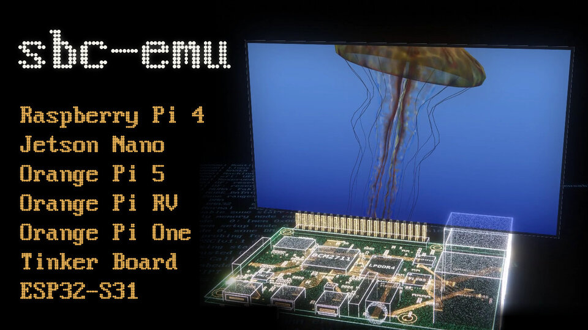
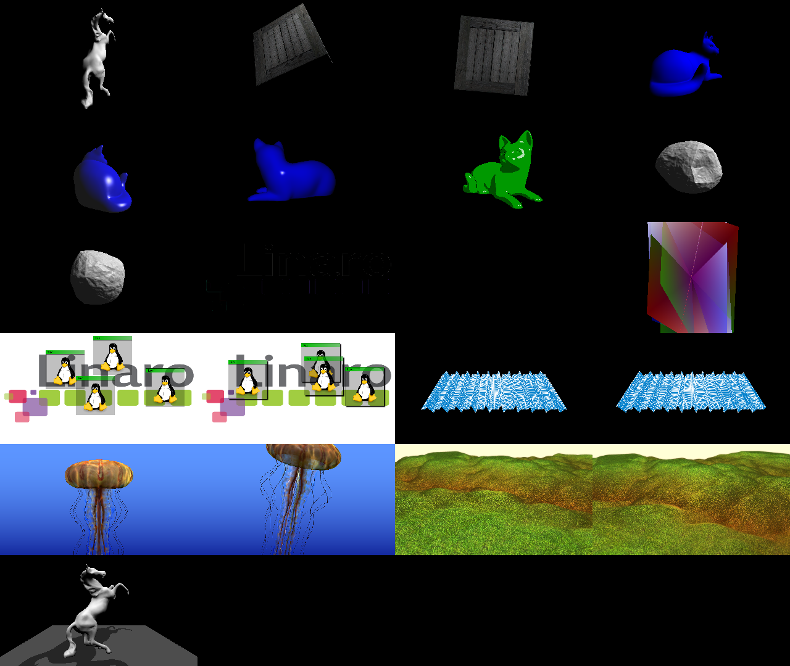
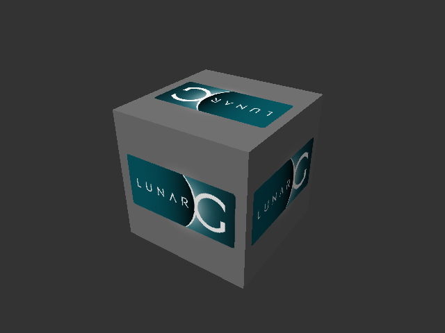

# sbc-emu

[](https://github.com/joakimeriksson/sbc-emu/actions/workflows/ci.yml)

**Single-board computers, emulated instruction by instruction in Rust.** sbc-emu has its own CPU
cores and register-level models of each board's chips, and runs the boards' own operating
systems unmodified: Raspberry Pi OS, Ubuntu, Armbian, Alpine.

**Try it in your browser: [joakimeriksson.github.io/sbc-emu](https://joakimeriksson.github.io/sbc-emu/).**
All seven boards boot there, on your own computer: the Raspberry Pi 4, the Orange Pi One, the ASUS
Tinker Board S, the Orange Pi 5 and the RISC-V Orange Pi RV in seconds, the Jetson Nano in about 15,
and the ESP32-S31 through its whole boot chain in about 10.

**The film:** [seven boards in 70 seconds](https://www.youtube.com/watch?v=LDYEcrK_I24). Each board's
screen was recorded from that emulated board, the 3D boards around the screens were drawn by the
emulated Jetson Nano's GPU, and the music was played by MilkyTracker on the emulated Raspberry Pi 4.

<a href="https://www.youtube.com/watch?v=LDYEcrK_I24"></a>

<table>
<tr>
<td></td>
<td></td>
<td></td>
</tr>
<tr>
<td>Raspberry Pi 4: glmark2 on the V3D GPU, stock Raspberry Pi OS and Mesa</td>
<td>Orange Pi 5: Mesa's Panfrost rendering on the Mali-G610, shown on HDMI</td>
<td>Orange Pi RV (RISC-V): vkcube on the PowerVR GPU with Mesa's Vulkan driver</td>
</tr>
</table>

## Boards

| Board | Chip | What runs | Details |
|---|---|---|---|
| Raspberry Pi 4 Model B | Broadcom BCM2711, 4× Cortex-A72 | Raspberry Pi OS and Ubuntu 26.04 Desktop; the V3D GPU with OpenGL ES 3.1 and Vulkan 1.3; HDMI, USB, network, audio. Also in the browser. | [raspberry-pi-4.md](docs/raspberry-pi-4.md) |
| Orange Pi 5 | Rockchip RK3588S, 4× Cortex-A76 + 4× A55 | Armbian to its login prompt on eight cores; HDMI, USB 3.0, NVMe, Ethernet, audio; the Mali-G610 GPU (`--gpu probe`) with Mesa's Panfrost: kmscube and glmark2 on HDMI. Also in the browser. | [orangepi5.md](docs/orangepi5.md) |
| Orange Pi One | Allwinner H3, 4× Cortex-A7 | Armbian to its login prompt; HDMI, USB, Ethernet; the Mali-400 GPU. Also in the browser. | [orangepi-one.md](docs/orangepi-one.md) |
| Orange Pi RV | StarFive JH7110, 4× SiFive U74 (RISC-V) | the board's own boot chain from its SPI flash or SD card to Alpine, Xunlong's kernel or Canonical's Ubuntu 24.04.5, unmodified; Wi-Fi, NVMe; the PowerVR GPU with Vulkan. Also in the browser. | [orangepi-rv.md](docs/orangepi-rv.md) |
| ASUS Tinker Board S | Rockchip RK3288, 4× Cortex-A12 | Armbian from SD or eMMC to a login on HDMI; the Mali-T760 GPU with Panfrost. Also in the browser. | [tinkerboard.md](docs/tinkerboard.md) |
| NVIDIA Jetson Nano | Tegra X1, 4× Cortex-A57 | Debian 13 from the microSD card with Debian's own kernel; Ethernet, USB, HDMI; the Maxwell GPU through nouveau and Mesa (OpenGL ES 3.2). Also in the browser. | [jetson-nano.md](docs/jetson-nano.md) |
| ESP32-S31 Function CoreBoard | Espressif ESP32-S31, 2× RV32IMAC | Espressif's official Linux flash image, from the mask ROM to a shell. Also in the browser. | [esp32s31.md](docs/esp32s31.md) |

The Raspberry Pi 4 is complete enough for real use; the other boards are experimental. Each
board's page says exactly what works, how it was tested and what is missing.

## Quick start

One command boots a board to a shell in your terminal (macOS or Linux, with
[Rust](https://rustup.rs)). The first run builds sbc-emu and fetches a small, checksummed guest:

```sh
git clone https://github.com/joakimeriksson/sbc-emu && cd sbc-emu
scripts/quickstart.sh pi4b      # or orangepi5, orangepi-one, tinkerboard, orangepi-rv, jetson-nano, esp32s31
```

`Ctrl-A x` quits. **[Getting started](docs/getting-started.md)** has every board, the full
operating systems (Raspberry Pi OS, Armbian, Ubuntu, Debian) with a fetch script for each, the
screen over VNC, and gdb (`--gdb PORT`, on every board: [debugging](docs/debugging.md)).
The repository holds no operating system images: the scripts fetch them, checksummed, from their
publishers (the ESP32-S31's, built from Espressif's sources, from this project's releases).

## Getting sbc-emu

Prebuilt binaries for macOS (Apple silicon) and Linux x86-64 are attached to
[GitHub Releases](https://github.com/joakimeriksson/sbc-emu/releases) from v0.1.0. Or build it
with [Rust](https://rustup.rs); the toolchain is pinned in `rust-toolchain.toml`, and rustup
installs it on first use:

```sh
cargo build --release              # the binary is target/release/sbc-emu
target/release/sbc-emu boards list
```

The guests are not in the binary: they come from the fixture scripts in a clone of this
repository (`scripts/*-fixture.sh`). With a release binary, clone the repository for them and
run `sbc-emu run ...` as in [getting started](docs/getting-started.md); `scripts/quickstart.sh`
builds sbc-emu from source.

| Host | |
|---|---|
| macOS on Apple silicon | JIT for every board |
| Linux on AArch64 or x86-64 | JIT for every board |
| macOS on Intel | interpreter only, about ten times slower; untested (not in CI) |
| Windows | not supported |
| A web browser | all seven boards, with JITs to WebAssembly |

To build the browser site locally (it needs `rustup target add wasm32-unknown-unknown` once,
Node and `xz`):

```sh
tools/site-build.sh && python3 -m http.server -d out/site 8792
```

## How it works

- **Four CPU cores, written for this project:** 64-bit Arm (`arm-a64`), 32-bit Arm with Thumb-2
  (`arm-a32`), 64-bit RISC-V (`riscv64`) and 32-bit RISC-V (`riscv-rv32`, from
  [esp32sim](https://github.com/mikroverk/esp32sim)). Each has a JIT to AArch64, to x86-64 (on
  Linux) and to WebAssembly ([jit.md](docs/jit.md)).
- **One model per SoC:** the interrupt controller, timers, storage, display, USB, network and
  GPU, down to the registers the stock Linux drivers use.
- **One deterministic virtual clock:** by default the same run gives the same result every time.
- **The same machine in the browser,** compiled to WebAssembly and run in a Web Worker.

More in [how the boards share code](docs/architecture.md).

## Documentation

- [Getting started](docs/getting-started.md): every board in one command, then the full operating systems
- The boards: [Raspberry Pi 4](docs/raspberry-pi-4.md) (with a comparison with QEMU's `raspi4b`),
  [Orange Pi 5](docs/orangepi5.md), [Orange Pi One](docs/orangepi-one.md),
  [Orange Pi RV](docs/orangepi-rv.md), [Tinker Board S](docs/tinkerboard.md),
  [Jetson Nano](docs/jetson-nano.md), [ESP32-S31](docs/esp32s31.md)
- The GPUs: [V3D](docs/gpu.md) (Raspberry Pi 4), [Mali-G610](docs/orangepi5-gpu.md),
  [Mali-400](docs/orangepi-one.md#the-gpu), [Mali-T760](docs/mali-t760.md),
  [Maxwell](docs/jetson-nano-gpu.md)
- [Snapshots](docs/snapshots.md), [debugging with gdb](docs/debugging.md)
- [The JIT](docs/jit.md), [how the boards share code](docs/architecture.md),
  [tests and source layout](docs/development.md), [design decisions](docs/decisions.md)
- [Changes in each release](CHANGELOG.md)
- [The plans and development records](docs/history/) the boards were built from

## Contributing

Contributions, from people and from coding agents, go through pull requests.
[CONTRIBUTING.md](CONTRIBUTING.md) has the rules: one branch per change, the tests to run before
pushing, and what never goes into the repository.

## License

BSD 3-Clause ([LICENSE](LICENSE)), except the crates that came from esp32sim, which keep its MIT
license and co-authors: `riscv-rv32/` ([its LICENSE](riscv-rv32/LICENSE)) and `espressif/`
([its LICENSE](espressif/LICENSE); the SAR ADC calibration tables in `esp-periph` are Apache-2.0,
[LICENSE-ADC](espressif/esp-periph/LICENSE-ADC)).

sbc-emu includes no operating system images or vendor firmware binaries; you bring your own. (The
RV32 decoder tests compare against sampled `objdump` listings of Espressif's published ROM ELFs, and
the PowerVR "firmware" file is a stand-in the emulator generates, with no Imagination code.)

Raspberry Pi is a trademark of Raspberry Pi Ltd. Orange Pi, ASUS Tinker Board, Rockchip,
Allwinner, StarFive, Broadcom, NVIDIA, Jetson, Tegra, Arm, Mali, PowerVR, Espressif, ESP32,
Ubuntu and Debian are trademarks of their respective owners. sbc-emu is an independent project,
not affiliated with or endorsed by any of them; the names only say which hardware it emulates.
