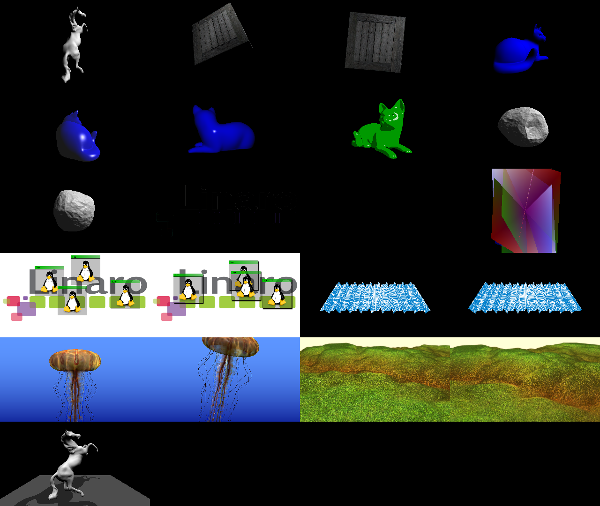

# The V3D 3D GPU

The BCM2711's VideoCore VI 3D block (V3D 4.2.14) is modelled in the `v3d` crate, well enough
for the stock Raspberry Pi OS kernel driver (`v3d`) and Mesa's userspace drivers (`v3d` for
OpenGL ES 3.1 / OpenGL 2.1, `v3dv` for Vulkan 1.3) to run unmodified. Display output goes through
the separately modelled vc4 KMS pipeline (HVS, pixel valve, HDMI), as on the real board.

There is no public hardware specification for V3D 4.x. The model is derived from the code that
drives the hardware:

- the kernel driver (`drivers/gpu/drm/v3d`): registers, MMU, job submission, interrupts;
- Mesa's `src/broadcom/cle/v3d_packet.xml`: every control-list packet and state record
  (`tools/gen_v3d_packets.py` generates `v3d/src/packets.rs` from it);
- Mesa's QPU packer/disassembler (`src/broadcom/qpu`): the 64-bit instruction encoding;
- Mesa's compiler (`src/broadcom/compiler`): the instruction semantics it relies on (signal
  latencies, flags, TMU/TLB/VPM protocols, payload registers, varyings);
- Mesa's gallium and Vulkan drivers: memory layouts, tile sizes, mip chains, TFU and CSD setup.

## What is modelled

| Part | Model |
|---|---|
| Hub / core registers | identification (4.2 rev 14, 1 core, 8 QPUs, TFU, MMU), interrupts (one line, SPI 74), caches (flushes complete at once), performance-counter registers |
| MMU | single-level page table of 4 KiB entries (64 KiB/1 MiB pages are filled as 4 KiB entries by the driver), 32-bit virtual space to RAM |
| Jobs | binning (CT0), rendering (CT1), TFU and CSD start when the kernel writes the kick register; results are computed then, the done interrupt follows after the host time the job took (`SBC_GPU_TIME` scales it; 0 = at once) |
| Control lists | branches and sub-lists, all state packets of `v3d_packet.xml`, draws (arrays, indexed with restart, instanced, indirect), base vertex/instance |
| Vertex pipeline | attribute fetch (float, half, fixed, byte/short/int, 2_10_10_10, normalised, integer, instance divisors, default values), coordinate and vertex shaders on the VPM layout Mesa compiles for |
| Primitives | points, lines, line loops/strips, triangles, strips, fans (GL and D3D provoking vertex), culling by facing, clipping against the near/far planes and a ±16k-pixel guard band (polygon clipping in clip space, varyings interpolated there) |
| Binning | per-tile primitive lists (kept on the host, keyed by the tile allocation address the render job names; a restored snapshot re-bins) |
| Rasterization | 1/256-pixel fixed point, top-left fill rule, 2×2 quads, 4× MSAA coverage, wide lines, points with point coordinates, scissor/clip window, polygon offset |
| Fragment shading | 16-lane QPU threads of four quads; payload W / centroid W / Z, perspective-correct, noperspective and flat varyings through `ldvary`, implicit point/line varyings, primitive ID |
| Per-sample ops | early and late depth (32F/24/16) and stencil tests with front/back state, occlusion queries, blending (all factors, add/sub/rsub/min/max/mul), colour write masks, TLB reads (framebuffer fetch) |
| Tile buffer | per render target internal type (8-bit unorm, 8/16/32-bit integers, f16, f32), clears, loads and stores to raster, LT, UB-linear and UIF (XOR) layouts with format conversion (RGBA8, sRGB, 565, 4444, 5551, 10_10_10_2, 11_11_10F, f16/f32/int formats, D32F, D24S8, D16, S8), R/B swap, Y flip, MSAA resolve |
| QPU | the V3D 4.2 instruction set: add/mul ALU ops with input unpacks and output packs, conditions, flag push/update, branches with delay slots and uniform-stream branches, thread switches (last-thread-switch protocol), signals (`ldunif*`, `ldtmu`, `ldvary`, `ldtlb*`, `wrtmuc`, small immediates, rotate), SFU ops, VPM loads/stores, multiply via MULTOP/UMUL24 |
| TMU | texture lookups (1D/2D/3D/cube/arrays, nearest/bilinear/trilinear, all wrap modes and border colours, LOD from quad derivatives or explicit, bias, offsets, gather, shadow compare, swizzles, sRGB, 16- and 32-bit returns); uncompressed formats, ETC2/EAC, BC1-3; general memory loads, stores and atomics |
| TFU | retiling copies and mipmap generation (2×2 box filter) |
| CSD | compute dispatch: workgroups, supergroups, 16-invocation batches, payload registers, barriers |

Not modelled: ASTC textures, transform feedback, geometry/tessellation shaders (V3D 4.2 has
them but Mesa only uses them for GL 3.2+ features), the multisample flag stack ops, dithering.
Performance counters read 0.

## Evaluation

All checks run in the guest, on the stock Raspberry Pi OS Lite image with Mesa 26.2 from its
repositories (`scripts/raspios-gpu-setup.txt`, `scripts/raspios-gpu-devtools.txt` prepare a
persistent copy of the image with `--sd-persist`).

**Pixel comparison against Mesa's software renderers** (`tests/gpu/`, `scripts/gpu-gltest.txt`;
start `tools/gpu_server.py` on the host first): the same scenes are rendered on the emulated
V3D and on llvmpipe (OpenGL ES) or lavapipe (Vulkan) in the same guest, then compared pixel by
pixel. A scene passes when fewer than 1% of its pixels differ by more than 12/255 in any channel.

**kmscube** (`scripts/gpu-kmscube.txt`): the rotating, lit cube on HDMI at 60 fps.

**glmark2-es2-drm** (`scripts/gpu-glmark2.txt`): the full benchmark at 1920×1080 on HDMI.
glmark2's own `--validate` is not used as ground truth: its 2023.01 references fail in the same
places on llvmpipe in this guest (`scripts/gpu-glmark2-validate.txt` runs both).

**Vulkan** (`vulkaninfo`, `tests/gpu/vktest.c`).

**The Mesa that Ubuntu's snaps use** (`tests/gpu/run-snap-mesa.sh`): Ubuntu 26.04 runs GNOME on
its own Mesa (26.0) but Firefox, a snap, on the `mesa-2404` snap's Mesa 25.2. The same scenes
run in the Ubuntu guest against that Mesa and its llvmpipe; `tests/gpu/build.sh` builds the
program in the Pi OS guest first (Ubuntu Desktop has no compiler), and
`tests/gpu/dump-snap-mesa.sh` dumps that Mesa's QPU code for a scene (`V3D_DEBUG=qpu,fs`). Its
compiler puts real work in all three branch delay slots, which caught the emulator running only
two of them (scatter128 failed, Firefox lost rectangles and drew stray glyphs).

Firefox also found what no scene did: the TMU cached each texture setup by the address of its
records for the whole job, but Mesa's PBO uploads (a buffer-texture view per `glTexSubImage2D`
from a pixel buffer, drawn into the glyph atlas) free and reuse that memory within one job, so
later uploads read the first one's size and buffer and glyphs came out blank. Cached setups are
now checked against the records' bytes. `SBC_V3D_DRAWS=1` also lists each distinct texture setup
(format, size, tiling, swizzle, how it is sampled), which is how that showed up.

## Results (November 2026, Raspberry Pi OS Lite trixie, kernel 6.18.50, Mesa 26.2.6)

### Pixel comparison against llvmpipe / lavapipe (128×128 scenes)

| Scene | API | Result |
|---|---|---|
| clear, tri_color, flat, depth, blend | GLES 3.1 | pass (max channel difference 0–1) |
| tex_nearest, tex_linear_mip (TFU mipmaps, trilinear, repeat/mirror) | GLES 3.1 | pass (max 5) |
| cube (lit, perspective, depth, culling) | GLES 3.1 | pass (max 1) |
| stencil, scissor, discard_fragcoord (gl_FragCoord, gl_FrontFacing) | GLES 3.1 | pass (max 0) |
| points_lines (6-pixel points, lines) | GLES 3.1 | pass (0.01% of pixels differ: line end pixels) |
| instanced_indexed (instancing, gl_VertexID, primitive restart) | GLES 3.1 | pass (max 1) |
| derivatives_math (dFdx/dFdy, sin, exp2, log2, pow, inversesqrt) | GLES 3.1 | pass (max 1) |
| cubemap, rgba16f_target (render to f16, sample back) | GLES 3.1 | pass |
| compute (shared memory, barrier, SSBO) | GLES 3.1 | exact (256 of 256 values) |
| text_dual_source, text_const_color, text_r8_alpha, tex_bgra (glyph masks: dual-source and constant-colour blending, R8 and BGRA textures, texture swizzles) | GLES 3.1 | pass (max 1) |
| depth_ids, instanced_int, vs_fetch, tex_array, scatter128 (WebRender's habits: front-to-back depth ids 2^-22 apart, integer instance attributes, vertex texelFetch from RGBA32F/RGBA32I, array textures, 1-pixel points into RGBA32F/RGBA32I) | GLES 3.1 | pass (max 1) |
| glyph_copies, big_tex_layout, render_big_targets, row_uploads, many_instances, partial_update, small_cache (partial tile updates with scissored colour and depth clears; 1024x1 and 1024x2 LT-tiled data textures written by points and read by a vertex shader; 1024 instanced quads fetching their rectangles by gl_InstanceID; single- and multi-row PBO uploads into 1024-wide RGBA32F/RGBA32I textures, as WebRender updates its GPU cache; staged glyphs copied into atlases by copy-image, framebuffer blit and CopyTexSubImage; 2048² and 1024x4096 R8/RG8/RGBA8 textures read across their whole XOR-tiled area, after CPU upload and after rendering into them) | GLES 3.1 | pass (max 0–1) |
| atlas_pbo (pixel-unpack uploads with row length and skips into 1024² RGBA8 and 2048² R8 atlases) | GLES 3.1 | texelFetch and RGBA8 exact; R8 with LINEAR at texel centres differs: llvmpipe returns the average of two neighbours there, V3D the texel |
| vk_depth_tris (depth test, push constants) | Vulkan 1.1 | pass (max 1) |
| vk_texture_blend (staging upload, vkCmdBlitImage mipmaps, trilinear, blending) | Vulkan 1.1 | pass (max 4) |
| vk compute (shared memory, barrier, storage buffer) | Vulkan 1.1 | exact (1024 of 1024 values) |

### kmscube

The cube rotates, lit, on HDMI: 60 fps when GPU time is not charged (`SBC_GPU_TIME=0`), 30 fps
with it (each 1080p frame takes about 24 ms of host time, so every other vblank is missed). A
snapshot taken mid-run restores and the run continues to its last frame.

### Vulkan

`vulkaninfo` lists `V3D 4.2.14.0` (driver `V3DV Mesa`, Vulkan 1.3, conformance version 1.3.8.3)
next to lavapipe. Through VK_KHR_display, v3dv finds the HDMI monitor (`sbc-emu HDMI 1920x1080`,
13 modes, one plane), and `tests/gpu/vkdisp.c` (`scripts/gpu-vkdisp.txt`) presents 1500 frames
from a FIFO swapchain on it: v3dv allocates the images on vc4, clears them on the V3D, and vc4
scans them out. `vkcube --wsi display` (vulkan-tools 1.4.304) segfaults in the client during
instance setup on this image, before any GPU work, even with only the v3dv driver and the
device-select layer turned off; the same Vulkan calls work from the small test program, so it
is not part of the evaluation.

### glmark2-es2-drm 2023.01 at 1920×1080 (all scenes, default durations)

glmark2 score **12**. The frame rates are guest-time rates: each GPU job's done interrupt is held back
by the host time the job took, so they show how fast the interpreted GPU is on the host
(here an Apple-silicon Mac), not how fast a real Pi 4 is.



| Scene | Options | FPS | Frame time |
|---|---|---|---|
| build | `use-vbo=false` | 45 | 22.487 ms |
| build | `use-vbo=true` | 45 | 22.445 ms |
| texture | `texture-filter=nearest` | 20 | 52.561 ms |
| texture | `texture-filter=linear` | 14 | 72.126 ms |
| texture | `texture-filter=mipmap` | 13 | 80.173 ms |
| shading | `shading=gouraud` | 29 | 35.565 ms |
| shading | `shading=blinn-phong-inf` | 16 | 66.194 ms |
| shading | `shading=phong` | 10 | 107.283 ms |
| shading | `shading=cel` | 9 | 117.356 ms |
| bump | `bump-render=high-poly` | 10 | 106.374 ms |
| bump | `bump-render=normals` | 19 | 55.441 ms |
| bump | `bump-render=height` | 13 | 78.955 ms |
| effect2d | `kernel=0,1,0;1,-4,1;0,1,0;` | 2 | 551.312 ms |
| effect2d | `kernel=1,1,1,1,1;1,1,1,1,1;1,1,1,1,1;` | 3 | 488.422 ms |
| pulsar | `light=false:quads=5:texture=false` | 16 | 65.404 ms |
| desktop | `blur-radius=5:effect=blur:passes=1:separable=true:windows=4` | 1 | 1969.127 ms |
| desktop | `effect=shadow:windows=4` | 2 | 620.023 ms |
| buffer | `columns=200:interleave=false:update-dispersion=0.9:update-fraction=0.5:update-method=map` | 9 | 117.919 ms |
| buffer | `columns=200:interleave=false:update-dispersion=0.9:update-fraction=0.5:update-method=subdata` | 9 | 117.324 ms |
| buffer | `columns=200:interleave=true:update-dispersion=0.9:update-fraction=0.5:update-method=map` | 9 | 114.830 ms |
| ideas | `speed=duration` | 11 | 96.026 ms |
| jellyfish | `<default>` | 3 | 450.617 ms |
| terrain | `<default>` | 1 | 3593.874 ms |
| shadow | `<default>` | 5 | 202.282 ms |
| refract | `<default>` | 2 | 997.737 ms |
| conditionals | `fragment-steps=0:vertex-steps=0` | 24 | 43.394 ms |
| conditionals | `fragment-steps=5:vertex-steps=0` | 9 | 124.901 ms |
| conditionals | `fragment-steps=0:vertex-steps=5` | 23 | 43.956 ms |
| function | `fragment-complexity=low:fragment-steps=5` | 16 | 66.116 ms |
| function | `fragment-complexity=medium:fragment-steps=5` | 10 | 106.698 ms |
| loop | `fragment-loop=false:fragment-steps=5:vertex-steps=5` | 15 | 66.686 ms |
| loop | `fragment-steps=5:fragment-uniform=false:vertex-steps=5` | 16 | 66.449 ms |
| loop | `fragment-steps=5:fragment-uniform=true:vertex-steps=5` | 11 | 96.275 ms |

## In the browser

`web/index.html` runs the 3D demos in the WebAssembly build: it restores a snapshot of Raspberry
Pi OS with Mesa, logged in on the HDMI console with every demo already run once (so the program
files, Mesa and the shader cache are in the guest's page cache), and types each demo's command
on the USB keyboard. The V3D model is the same Rust code as natively; in WebAssembly the job
timing uses `performance.now()` through the `sbc_host_now_ms` import.

```sh
cp -c cache/os/raspios-gpu.img cache/os/raspios-gpu-demo.img   # frozen: the snapshot refers to it
sbc-emu run --sd cache/os/raspios-gpu-demo.img --hdmi-mode 1024x768 --script scripts/gpu-demo-snapshot.txt
ln -s ../../cache/os/raspios-gpu-demo.img web/assets/raspios-gpu.img
tools/wasm-build.sh && tools/serve.py     # http://127.0.0.1:8791/  (?demo=cube starts one at once)
```

`--hdmi-mode WxH` plugs in a monitor whose preferred mode is 1920×1080, 1280×720, 1024×768,
800×600 or 640×480; the console, `kmscube` and `glmark2` use it. The demos use 1024×768: at
800×600 `glmark2-es2-drm` fails to set up its canvas. Snapshots keep the monitor's EDID, so a
restored guest that re-probes the connector keeps its mode.

`tools/wasm-gpu-bench.mjs` runs the same snapshot in Node (V8, as in Chrome), types each demo and
reports its frame rate; `tools/browser-check.mjs URL PREFIX SECS...` drives headless Chrome over
the DevTools protocol and saves screenshots. At 1024×768 (Node 26, M5, one thread):

| Demo | WebAssembly | native |
|---|---|---|
| `kmscube` | 43 fps | 60 fps (vsync) |
| `glmark2` build (horse) | 36 fps | 56–65 fps |
| `shading:shading=phong` | 11 fps | 18 fps |
| `jellyfish` | 2.5 fps | 4–6 fps |
| `desktop:effect=shadow` | 4 fps | 4–5 fps |

The QPU interpreter resolves each ALU operation's operand unpacking once per instruction and
then runs a plain loop over the 16 lanes, with branch-free denormal flushing, so the compiler
vectorises it (NEON natively, SIMD128 in the WebAssembly build). That cut the
render time of a Phong frame from 81 ms to 56 ms natively and raised the browser's Phong rate
from 4.4 to 7.1 fps (at 1080p). The glmark2 table above was measured before that change.
Texture-heavy scenes (jellyfish, refract, terrain) spend their time in texture fetch and
filtering instead.

## Debugging aids

- `SBC_V3D_LOG=1`: one line per bin job, the first vertex shader output of each draw, the first
  tile buffer writes and stores.
- `SBC_V3D_TRACE=N`: trace the next N QPU instructions (decoded op, flags, lane-0 register
  changes); compare with Mesa's own disassembly from `V3D_DEBUG=qpu,vir` in the guest
  (`scripts/gpu-shaders.txt`).
- `SBC_V3D_DRAWS=1`: one line per distinct draw state (render-target types, blend factors and
  equations, depth and stencil, early Z, fragment shader address) and per distinct tile store
  format: what an application asks of the GPU, without tracing every draw.
- `SBC_GPU_TIME=X`: scale the guest time GPU jobs take (default 1: their host time; 0: instant).
