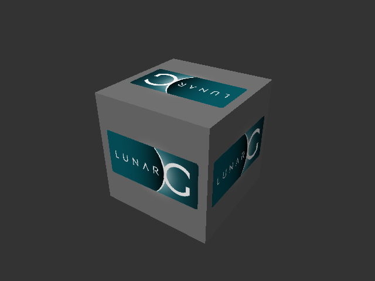

# Orange Pi RV (StarFive JH7110)

`--board orangepi-rv`, experimental.

Xunlong's Orange Pi RV: the StarFive JH7110 with four SiFive U74 cores (RV64GC, Sv39) and
an S7 monitor core, 4 GiB of LPDDR4, a microSD slot, SPI NOR, Gigabit Ethernet, four USB
3.0 ports (a VL805 on PCIe), HDMI 2.0 and an M.2 slot. sbc-emu runs it on its own RV64
interpreter and JIT (`riscv64/`, no QEMU) and SoC model (`starfive-jh7110/`). The CPU, the microSD
card, Gigabit Ethernet, the four USB 3.0 ports (PCIe → VL805) with a keyboard, tablet and USB
stick, an NVMe SSD in the M.2 slot, Wi-Fi and Bluetooth (the AP6256), audio from the
headphone jack's PWM DAC, the HDMI output with HDMI audio, and the PowerVR GPU (Vulkan) work.
It also runs in the browser (below).

Two unmodified kernels boot on it:

| Kernel | Device tree | Works |
|---|---|---|
| Alpine `linux-stable` 7.1.5 (mainline) | mainline `jh7110-orangepi-rv.dtb` | shell, SMP, microSD, Ethernet, USB 3.0, M.2 NVMe, Wi-Fi (`brcmfmac`), audio, **HDMI** (the firmware's framebuffer under `simpledrm`), reboot/poweroff |
| Xunlong's own kernel (`orangepi-xunlong/linux-orangepi`, branch `orange-pi-5.15-jh7110`, StarFive's 5.15 BSP), built with `orangepi-build`'s `linux-starfive2-current` config | its `jh7110-orangepi-rv.dtb` | shell, SMP, microSD, Ethernet, USB 3.0, M.2 NVMe, Wi-Fi (`bcmdhd`), Bluetooth, audio, **HDMI** (DC8200 + Inno HDMI, fbcon) with the USB keyboard, HDMI audio, RSA on the crypto engine |

```sh
scripts/orangepi-rv-fixture.sh             # pinned Alpine downloads -> cache/orangepi-rv/
scripts/orangepi-rv-vendor-kernel.sh       # Xunlong's kernel, built in Docker, and an initramfs with
                                           # its Wi-Fi/Bluetooth modules -> cache/orangepi-rv/vendor/
F=cache/orangepi-rv; V=$F/vendor
# mainline
sbc-emu run --board orangepi-rv --firmware $F/fw_dynamic.bin --kernel $F/Image \
    --dtb $F/jh7110-orangepi-rv.dtb --initrd $F/initramfs.cpio.gz     # Ctrl-A x quits
# the board's own kernel, with an SD card, a USB stick, Ethernet and the HDMI output on VNC :1
# (the VNC keyboard and pointer are the USB keyboard and tablet)
sbc-emu run --board orangepi-rv --firmware $F/fw_dynamic.bin --kernel $V/Image \
    --dtb $V/jh7110-orangepi-rv.dtb --initrd $V/initramfs.cpio.gz --sd card.img --usb-drive stick.img \
    --append "console=tty0 console=ttyS0,115200 earlycon rdinit=/init" --vnc :1
# --smp 1..4 (default 4), --ram-mb N (default 4096), --net nat|local|none (default nat),
# --hdmi-mode 1280x720|1920x1080|640x480, --screenshot OUT.png, --sd-persist, --script FILE,
# --usb-drive IMAGE (a USB stick), --nvme IMAGE (an NVMe SSD in the M.2 slot),
# --audio-out FILE.wav (what the headphone jack or HDMI plays; raw 16-bit stereo to any other path)
# SBC_NET_LOG=1 in the environment logs the NAT's DHCP, ARP, TCP and UDP relaying
```

There are three ways to boot.

**From the board's SPI flash, as the board boots** (`--spi-flash`, no `--kernel`): the flash holds
the board's firmware (U-Boot SPL at 0, U-Boot's environment at 0xf0000, U-Boot and OpenSBI at
1 MiB), and that U-Boot boots whatever is on the microSD card, NVMe or USB: an unmodified
distribution image (Ubuntu, below), or the card described next.

```sh
scripts/orangepi-rv-uboot.sh   # also writes cache/orangepi-rv/uboot/spi-flash.img (16 MiB)
scripts/orangepi-rv-ubuntu.sh  # Ubuntu 24.04.5 for JH7110 boards (1.1 GB download, checked) -> cache/orangepi-rv/ubuntu/
sbc-emu run --board orangepi-rv --spi-flash cache/orangepi-rv/uboot/spi-flash.img \
    --sd cache/orangepi-rv/ubuntu/ubuntu-24.04.5-preinstalled-server-riscv64+jh7110.img --ram-mb 4096
#   log in as ubuntu / ubuntu (the image asks for a new password at first login)
sbc-emu run --board orangepi-rv --spi-flash cache/orangepi-rv/uboot/spi-flash.img --sd CARD.img --ram-mb 4096
```

The boot-mode straps then select the QSPI flash, and the boot ROM loads SPL from it; SPL loads
U-Boot from the flash through the Cadence QSPI controller, and U-Boot keeps its environment
there (`saveenv` works). Writes to the flash stay in memory: the file is never changed.

**From the microSD card, through the board's own boot chain** (no `--kernel`, no `--spi-flash`):

```sh
scripts/orangepi-rv-uboot.sh   # mainline U-Boot v2026.10 in Docker, and a bootable card -> cache/orangepi-rv/uboot/
sbc-emu run --board orangepi-rv --sd cache/orangepi-rv/uboot/sdcard.img
```

1. **The mask ROM** (modelled, not run): the boot-mode straps select SD. The ROM reads the
   SPL header at the start of the card, or at its backup offset (2 MiB, the `spl`
   partition), checks its CRC-32, copies U-Boot SPL into the 2 MiB L2 LIM at 0x0800_0000,
   and starts the four U74s there.
2. **U-Boot SPL** (real) brings up the DDR controller. It reads the board EEPROM, whose
   product ID `XOPIRV` makes it pick the Orange Pi RV device tree, then loads `u-boot.itb`
   (OpenSBI and U-Boot) from GPT partition 2.
3. **OpenSBI and U-Boot** (real): U-Boot shows `Model: Xunlong Orange Pi RV`, probes the SD
   card, Ethernet (with the EEPROM's MAC address) and USB. Its distro boot finds
   `/boot/extlinux/extlinux.conf` on partition 3 and starts Linux with the DTB and initramfs
   named there.

The card from `scripts/orangepi-rv-uboot.sh` carries the mainline fixture's kernel. Any
card in StarFive's layout should boot the same way.

**Directly** (`--kernel`, `--dtb`, `--firmware`): the emulator plays the SPL and U-Boot parts:
- It loads OpenSBI at 0x4000_0000 and starts harts 1–4 there. A `fw_dynamic_info` names
  the kernel at 0x4020_0000 (S mode) as the next stage.
- It loads the device tree at 0x4600_0000 and the initrd at 0x4610_0000, U-Boot's
  `starfive_visionfive2` load addresses.
- It fills in `/chosen` and `/memory` as U-Boot would.

Real OpenSBI (Alpine's 1.8.1, generic platform) then runs the platform, HSM, IPIs, timer,
console and system reset.

For a kernel whose device tree has no display controller node (mainline), the firmware also
hands over the HDMI output, as U-Boot does on boards whose display mainline cannot drive yet:
- it sets up the DC8200 to scan out a framebuffer at the monitor's preferred mode;
- the framebuffer sits in the top 16 MiB of RAM below 4 GiB;
- it describes the framebuffer as a no-map `/reserved-memory` region and a
  `/chosen/framebuffer` `simple-framebuffer` node, which Linux's `simpledrm` drives.

Xunlong's kernel describes the DC8200 and Inno HDMI itself, so it gets no handoff and drives
them with its own DRM driver.

## Status

| | Status | Evidence |
|---|---|---|
| CPU | RV64IMAFDC + Zicsr, Zifencei, Zicntr, Zba, Zbb (the U74's `rv64imafdc_zba_zbb`), M/S/U at privileged 1.11, Sv39 with superpages and hardware A/D, no ASIDs; all 166 riscv-tests in the U74's ISA pass (`rv64ui/um/ua/uc/uf/ud/si/mi/uzba/uzbb -p`) | `scripts/riscv-tests.sh`, `cargo test -p riscv64` |
| Firmware | OpenSBI 1.8.1 reports `Platform Name: Xunlong Orange Pi RV`, 4 harts, aclint-mswi/mtimer, uart8250, `pm-reset` | `scripts/orangepi-rv-shell.txt` |
| Boot chain | From the SD card: the boot ROM loads U-Boot SPL 2026.10. SPL brings up DDR and loads OpenSBI and U-Boot from the card. U-Boot reports `Model: Xunlong Orange Pi RV` and `eth0: ethernet@16030000`, then boots Linux from the card's `extlinux.conf`. Linux mounts the card, has the EEPROM's MAC address on `eth0`, and gets a DHCP lease. About 72 s wall, 20 s guest time | `scripts/orangepi-rv-uboot.txt` |
| Ubuntu | **Canonical's Ubuntu 24.04.5 LTS server image for JH7110 boards, unmodified** (`scripts/orangepi-rv-ubuntu.sh` fetches and checks it). From the SPI flash: U-Boot 2026.10 finds the image's EFI system partition and starts its GRUB 2.12 over EFI; GRUB starts Ubuntu's kernel (`7.0.0-31-generic`, the 24.04.5 HWE kernel) and initrd; the kernel takes U-Boot's device tree (`Machine model: Xunlong Orange Pi RV`), mounts the card's root filesystem, and systemd and cloud-init run to `ubuntu login:`. The script logs in as the image's default user (`ubuntu`/`ubuntu`, changed at first login as the image requires), and checks the release, the kernel, the model, four CPUs, the flash in `/proc/mtd`, a DHCP lease and ping over Ethernet (`end0`), and `systemctl is-system-running` (`running`, no failed units). About 9 minutes wall on an M-series Mac with the interpreter (100 G instructions, 105 s guest time); `ubuntu login:` comes after about 77 G. Ubuntu's PWM DAC sound card does not come up: its `dw_axi_dmac` is a module that loads after the DAC probes, and the card gives up instead of waiting | `scripts/orangepi-rv-ubuntu.txt` |
| Shell | **mainline:** reaches the `orangepi-rv#` BusyBox prompt at about 3.3 s guest time (about 3.8 G instructions, 30 s wall on an M-series Mac). Checked in the script: `uname -a`; the DT model `Xunlong Orange Pi RV`; 4 CPUs with `rv64imafdc_…_zba_zbb` and `mmu: sv39`; `free -m` 3934 MB; double-precision `awk` math; `sleep 1`; timer and IPI interrupts on all four CPUs; four parallel shell loops | `scripts/orangepi-rv-shell.txt` |
| Reset | `reboot -f` resets through Linux's `gpio-restart` (GPIO35), and OpenSBI and Linux boot again. `poweroff -f` goes through OpenSBI SRST, then the AXP15060 PMIC's power register over I2C5, and the run ends | `scripts/orangepi-rv-reboot.txt` |
| microSD | DesignWare MMC (SDIO1, IDMAC) with card detect on GPIO41: `mmc1: new high speed SDHC card`. A host-made ext4 card mounts; a 4 MiB file written by the guest verifies after dropping the page cache; `fstrim` works; the data survives a guest reboot. The same works on Xunlong's kernel | `scripts/orangepi-rv-sd.txt`, `scripts/orangepi-rv-board.txt` |
| Ethernet | GMAC0 (DWMAC 5.10a, stmmac + `dwmac-starfive`) and the Motorcomm YT8531C PHY on MDIO: `Link is Up - 1Gbps/Full`. On sbc-net's virtual network: a DHCP lease of 10.0.2.15, pings to the gateway, and an HTTP fetch from the host's network through the NAT. Works on both kernels | `scripts/orangepi-rv-net.txt`, `scripts/orangepi-rv-board.txt` |
| USB 3.0 | PCIe0 (PLDA, `pcie-starfive`/`pcie_plda`) with the VL805 xHCI (`1106:3483`) signalling by MSI, as on the board. Both root hubs come up; a USB keyboard, tablet and `--usb-drive` stick enumerate. A key typed on the keyboard arrives as an input event. The stick's ext4 filesystem mounts, and a 2 MiB file written to it verifies after dropping the page cache. Works on both kernels | `scripts/orangepi-rv-usb.txt` |
| M.2 NVMe | `--nvme IMAGE` puts an NVMe 1.4 SSD on PCIe1 (class 010802, MSI). The `nvme` driver brings up its admin and I/O queues; the 64 MiB ext4 drive mounts; a 4 MiB file written to it verifies after dropping the page cache. Works on both kernels | `scripts/orangepi-rv-nvme.txt` |
| Wi-Fi | **mainline:** the AP6256's BCM43456 on SDIO0 (DW MMC with SDIO). `brcmfmac` loads the real `brcmfmac43456-sdio` firmware for `BCM4345/9`, and the emulated FullMAC host interface answers it (the radio and the proprietary firmware are not emulated). The scan finds the virtual access points `sbc-emu` and `sbc-emu-wpa2`; `iw connect` joins `sbc-emu`; DHCP 10.0.2.15 and ping over `wlan0` work. **Xunlong's kernel:** Broadcom's `bcmdhd` (`CONFIG_BCMDHD_OOB`) downloads Xunlong's `fw_bcm43456c5_ag.bin` and `nvram_ap6256.txt` and takes its interrupts on the out-of-band WL_HOST_WAKE line (GPIO21 through the GPIO interrupt controller); the same scan, join, DHCP and ping work | `scripts/orangepi-rv-wifi.txt` |
| Bluetooth | **Xunlong's kernel:** the AP6256's BCM4345C5 as an HCI controller on UART1 (H4). Xunlong's DT has no serdev node for it, so `hciattach /dev/ttyS1 any` attaches it as on the board's images; `hciconfig hci0 up` brings it to `UP RUNNING` with its name and address, and an LE scan (`hcitool lescan`) finds the virtual peripheral `sbc-emu sensor`. Mainline's DT leaves UART1 disabled | `scripts/orangepi-rv-bluetooth.txt` |
| Audio | The PWM DAC fed by the AXI DMA controller: Linux's `jh7110_pwmdac` with `dw-axi-dmac` cyclic DMA and simple-audio-card (`StarFive-PWMDAC-Sound-Card`). `speaker-test -t sine -f 440` at 48 kHz reaches `--audio-out` as a 440.0 Hz sine of the right length, on the left channel (`-s 1`). Works on both kernels | `scripts/orangepi-rv-audio.txt` |
| HDMI audio | **Xunlong's kernel:** I2STX_4CH0 (DesignWare I2S) fed by the AXI DMA controller into the Inno HDMI: `Starfive-HDMI-Sound-Card`. `speaker-test -D hw:1,0 -t sine -f 440` at 48 kHz reaches `--audio-out` as a 440 Hz sine; the I2S paces the DMA at the rate its clock dividers give | `scripts/orangepi-rv-hdmi-audio.txt` |
| HDMI (mainline) | The firmware framebuffer under `simpledrm`: `fb0` at 1280x720 with fbcon. The whole board on mainline in one run, about 45 s wall: microSD read/write; Ethernet with DHCP, ping and HTTP; the USB stick; the HDMI console, where a shell on `tty1` runs a command typed on the USB keyboard | `scripts/orangepi-rv-board-mainline.txt` |
| HDMI | **Xunlong's kernel:** StarFive's DRM driver binds the DC8200 and the Inno HDMI. The connector is `connected`, with the monitor's EDID offering 1280x720, 1920x1080 and 640x480. The HDMI PHY is programmed for 74.25 MHz; `fb0` carries the kernel console (160x45) at 1280x720 with vblank interrupts. Output goes to VNC (`--vnc :N`), `--screenshot` and the script's `screenshot FILE` | `scripts/orangepi-rv-hdmi.txt`, `scripts/orangepi-rv-board.txt` |
| GPU | The PowerVR BXE-4-32 with the open stack: mainline Linux's `powervr` driver in a kernel built with it (`scripts/orangepi-rv-gpu.sh`), and Mesa's PowerVR Vulkan driver. The driver probes the GPU node the firmware adds, loads the firmware file and boots the firmware, which the emulator plays. Runtime PM suspends and resumes the GPU. Mesa finds `PowerVR B-Series BXE-4-32 MC1`. A Vulkan compute dispatch (4096 invocations) gives correct results. Offscreen rendering clears and draws a colour-interpolated triangle, read back exactly. Debian's `vkcube --wsi display` shows the textured, lit cube on HDMI through KMS. Every pixel comes from Mesa's own shader programs, run on the emulated PDS and USC | `scripts/orangepi-rv-gpu.txt`, `scripts/orangepi-rv-gpu-vkcube.txt` |
| Board devices | Xunlong's kernel: the AXP15060 regulators (`hdmi_1p8`, `hdmi_0p9`, `vcc_3v3`, `cpu_vdd`, …) on I2C5; the 24C04 board EEPROM; the temperature sensor; the crypto engine's PKA, which verifies the kernel's X.509 certificates with RSA | `scripts/orangepi-rv-board.txt` |

The whole board in one run, on Xunlong's kernel (`scripts/orangepi-rv-board.txt`, about 25 s wall):
- microSD read/write;
- Ethernet with DHCP, ping and HTTP;
- the USB stick;
- the HDMI console, where a shell on `tty1` runs a command typed on the USB keyboard.


`vkcube` on the PowerVR BXE-4-32 (mainline `powervr`, Mesa's PowerVR Vulkan driver, 640x480):



## What is modelled

- **`riscv64/`: the hart.**
  - An interpreter with a fetch-page cache and a 1024-entry TLB, and the JIT (below).
  - Floating point runs on host IEEE arithmetic with RISC-V NaN boxing and canonical NaNs. The other rounding modes and the exception flags come from exact error terms.
- **`starfive-jh7110/`: interrupts and timers.** The CLINT (`mtime` at 4 MHz) and the PLIC (136 sources, 9 contexts).
- **`starfive-jh7110/`: the DRAM.** It is visible at 0x4000_0000 and through its uncached alias at +0x4_0000_0000, which the vendor kernel uses for coherent DMA.
- **`starfive-jh7110/`: SoC control.**
  - UART0, the shared DesignWare UART model.
  - The clock/reset generators, with Linux's reset-status semantics.
  - The PLL syscon.
  - The power-management unit's domains.
  - The system GPIO block's interrupt controller (level and edge, per-pin enables), with the board's GPIO35 restart line, GPIO41 card detect and GPIO21 Wi-Fi host wake as inputs.
  - UART1 with the AP6256's Bluetooth controller (`bluetooth.rs`, adapted from the Raspberry Pi 4's CYW43455 model): HCI over H4, Broadcom vendor commands, one virtual LE peripheral that advertises every 100 ms. No connections.
- **`dwmmc.rs`:** the two DesignWare MMC hosts, adapted from the RK3288 model.
- **`gmac.rs`:** GMAC0/GMAC1 (DWMAC4 descriptors, one DMA channel, no offloads advertised) and the YT8531C PHY (RGMII LDO strapped to 1.8 V, as the board's DT drive strengths need). GMAC1 has no PHY, as on the board.
- **`i2c.rs`:** the seven DesignWare I²C controllers, used polled by OpenSBI and with interrupts by Linux. I2C5 carries the AXP15060 PMIC and the 24C04 EEPROM.
- **`display.rs`:**
  - The DC8200: revision 0x5720, plane and panel registers, a 60 Hz vblank, and scanout of the primary planes in the XRGB8888, ARGB8888, RGB565, ARGB1555 and ARGB2101010 formats.
  - The Inno HDMI: hot-plug, PLL lock, and the EDID through its DDC FIFO, for a monitor whose EDID is sbc-emu's (as on the Orange Pi One).
- **`pcie.rs`, `xhci.rs`:**
  - The two PLDA PCIe root ports: ECAM configuration space, the root port bridge, 1:1 address translation, link status in the STG syscon, and INTx plus MSI (ISTATUS_MSI, with ISTATUS_LOCAL's MSI bit as its summary).
  - The VL805 on PCIe0, its xHCI adapted from the Raspberry Pi 4 model. Its interrupter's pending bit clears when an MSI goes out, and a halted controller does not interrupt.
  - PCIe1 is the M.2 slot: empty, or `nvme.rs`. That is an NVMe controller with admin and I/O queues, PRP lists, Identify/queue/feature/log commands, Read/Write/Flush/Write Zeroes/DSM, and one namespace of 512-byte blocks on a copy-on-write image.
- **`sdio.rs`, `wifi.rs`:**
  - SDIO in the DW MMC model: CMD5/3/7, CMD52, CMD53 through the IDMAC or the FIFO, and the card interrupt as RINTSTS bit 16.
  - The BCM43456, adapted from the Raspberry Pi 4's CYW43455 model: chip revision 9, SDIO ID `02d0:4345`. It answers both `brcmfmac` and `bcmdhd` (their extra iovars, the two-byte event pad, scan results that arrive after the request's reply), and raises its interrupt on DAT[1] or on the WL_HOST_WAKE pin. The access point's network is isolated (DHCP, DNS, local services), as on the Pi.
- **`audio.rs`:**
  - The DesignWare AXI DMA controller: four channels with linked-list blocks. A block marked LLI_LAST stops the channel with DMA_TRF; the next block comes from CH_LLP. Memory-to-memory transfers complete at once.
  - The PWM DAC: transfers to it are paced by its sample rate, computed from the SYSCRG dividers and CNT_N.
  - I2STX_4CH0, the DesignWare I2S that feeds the Inno HDMI: paced by MCLK over its dividers and the word length.
- **`crypto.rs`:** the security engine's PKA, a Montgomery engine running the vendor driver's RSA sequence. The AES and SHA engines are not modelled.
- **`powervr/`: the GPU**, a PowerVR BXE-4-32 (BVNC 36.50.54.182).
  - Linux's `powervr` driver does not program the GPU's pipelines. It hands work to firmware on a MIPS microcontroller inside the GPU, through command rings in memory.
  - The model has the registers the driver uses: BVNC, reset, idle and MMU status, the MIPS wrapper and its interrupt, and the MTS doorbell.
  - It plays the firmware at that interface. It boots when the driver releases the MIPS core from reset, and finds the driver's init structures through the driver's MIPS page table. It reports the firmware started and idle, and serves the kernel command ring: power requests, MMU cache flushes, health checks and cleanups.
  - Imagination publishes no open-driver firmware for this core, so `powervr::firmware` makes the file the driver loads. It has the header, the MIPS layout and the core's device info (errata, enhancements and features from Imagination's DDK table and Mesa's `bxe-4-32.h`), and no firmware code.
  - It runs the jobs. Compute (CDM) dispatches kernels as PDS tasks.
  - Geometry (VDM) runs the vertex programs, clips (Sutherland-Hodgman, against w and z), culls and applies the viewport.
  - Fragment (16x16 tiles) runs the background object, edge-function rasterisation with depth, the coefficient and fragment programs in 2x2 quads (for derivatives), and the end-of-tile program through the PBE.
  - Transfer (TQ_3D) copies run the same tile loop.
  - `pds.rs` and `usc.rs` interpret the PDS and Rogue USC instruction sets, as far as Mesa's programs use them. `tpu.rs` samples textures: twiddled or strided, point or bilinear, with mip levels, LOD, wrap modes and sRGB.
  - Anything unmodelled faults loudly rather than rendering something wrong.
  - The firmware adds a GPU node to mainline's device tree (`img,img-bxe-4-32`, `img,img-rogue`), which has none yet. The core is not on the driver's supported list, so it needs `powervr.exp_hw_support=1`.
- **Boot devices** (`boot.rs`, `machine.rs`):
  - The boot ROM's SPI flash and SD paths and the 2 MiB L2 LIM at 0x0800_0000. The MMC's IDMAC reaches the LIM, where SPL keeps its buffers.
  - The boot-mode straps (the SPI flash with `--spi-flash`, otherwise SD) and the DDR controller's training handshake.
  - `qspi.rs`: the Cadence QSPI controller (STIG commands; indirect reads and writes through the SRAM FIFO and the AHB trigger window, as U-Boot and Linux use them; direct reads; its interrupt) and the board's 16 MiB SPI NOR flash, a GigaDevice GD25LQ128 (JEDEC ID, status registers, write enable, page program, 4/32/64 KiB and chip erase, the single, dual and quad reads). U-Boot's `sf` and Linux's `spi-nor` find it.
  - The 24C04 EEPROM in StarFive's format (`SFVF`, product `XOPIRVA1-2450-D004E000-…` with the DRAM size, MAC addresses, CRC-16s).
  - The bus clock dividers at the board's rates (APB 49.5 MHz from PLL2).
- **Other devices:**
  - The temperature sensor.
  - The TRNG, whose numbers come from a deterministic generator (not entropy).
  - All other device pages are read-back stand-ins; every run lists them at the end.
- **Virtual time:**
  - Each hart runs at 1 ns per instruction, round-robin in 1000-instruction slices.
  - When every hart waits in WFI, time skips to the next `mtimecmp`, vblank or network poll.

## In the browser

`web/board.html?b=orangepi-rv` boots the board in a browser tab: the WebAssembly build of the same
machine (`wasm/`, `sbc_boot_opirv`) with OpenSBI, Alpine's mainline kernel and device tree and a
small initramfs (`scripts/orangepi-rv-fixture.sh` writes it to `web/initramfs.cpio.gz`: Ethernet
and USB HID modules, no Wi-Fi, audio or SD), to a shell on the serial console. The browser's
network is isolated (DHCP, DNS and local services: `udhcpc` and `ping 10.0.2.2` work).

```sh
scripts/orangepi-rv-fixture.sh && tools/wasm-build.sh   # stages web/assets/orangepi-rv
tools/serve.py; open 'http://127.0.0.1:8791/board.html?b=orangepi-rv'
node tools/wasm-smoke-opirv.mjs                         # the same boot, headless (SBC_JIT=0: no JIT)
node tools/wasm-rv-jit-diff.mjs                         # the JIT against the interpreter
```

## The JIT

The harts run through a block JIT (`riscv64/src/jit.rs`) with two code generators: RISC-V to
AArch64 natively on AArch64 macOS and Linux hosts (`jit_a64.rs`; on by default, `--no-jit` or
`SBC_JIT=0` turns it off) and RISC-V to WebAssembly in the browser build (`jit_wasm.rs`). Other
hosts interpret.

- **Regions.** A hot entry (64 executions) is compiled with the basic blocks its constant branches
  reach on the same 4 KiB page, so loops run inside compiled code while the cycle budget lasts.
  Compiled: RV64I, M, Zba and Zbb (natively also `mulh*` and `rev8`; neither backend `orc.b`).
  CSRs, privileged instructions, AMOs and floating point go to the interpreter one instruction at
  a time; those that can change the mode, the address space or interrupt lines end the block.
- **Shared and keyed by physical address.** The four harts share the code, and a page mapped at
  several virtual addresses is compiled once; the code computes PCs from the page's virtual
  address.
- **Loads and stores** go through a 256-entry micro-TLB per mode (U, S, S with SUM, M), filled by
  the interpreter's page walks; misaligned and device accesses take the interpreter's path.
- **`fence.i`.** Code stays valid until a `fence.i`, as on the U74. After one, a region is
  compared with the bytes it was compiled from the first time it runs again, so code written by
  DMA is caught as well as stores. (Linux issues about 9,000 `fence.i`s while it boots, so
  dropping everything at each one is not an option.)

`cargo test -p riscv64` (natively, with the AArch64 backend; `SBC_JIT_CASES=n` for more) and
`node tools/wasm-rv-jit-diff.mjs` (the WebAssembly backend) run random programs (integer, M, Zba,
Zbb, loads and stores with misaligned, page-straddling and device accesses, AMOs, CSRs, compressed
instructions, branches, jumps and loops) in M mode and in S mode with Sv39, and compare
registers, counters, CSRs and memory with the interpreter: 120,000 cases natively and 18,000 in
WebAssembly match.

| Mainline to the BusyBox shell (M5) | Wall time | Instructions |
|---|---|---|
| Native, interpreter | 29.1 s | 6.7 G |
| Native, JIT | 7.7 s: the guest's own waits (7.7 s of guest time) now set the pace | 6.7 G |
| Browser build (Node 26), interpreter | 53.8 s (118 MIPS) | 6.6 G |
| Browser build, JIT | 9.9 s | 6.6 G |
| Browser build, JIT, the demo's initramfs | 4.6 s | 1.9 G |

Canonical's Ubuntu 24.04.5 image (`scripts/orangepi-rv-ubuntu.txt`: boot, login, network and
system checks, 104 G instructions, 112 s of guest time) takes 536 s interpreted and 162 s with
the native JIT.

CPU-bound, four shell loops of 300,000 iterations on the four harts (about 16 G instructions)
take 121.5 s interpreted and 14.3 s with the native JIT (8.5 times faster, about 1.6 G
instructions per second).

## Not working yet

- **USB 2.0:** the SoC's own USB 2.0/OTG controller (Cadence, the board's USB-C data role) is not modelled. The devices are emulated: a keyboard, a tablet and a USB stick (`--usb-drive`; a guest reboot starts again from the image).
- **Bluetooth on mainline:** mainline's DT leaves UART1 disabled and has no Bluetooth node. Bluetooth connections (ACL) are not modelled.
- **GPU:**
  - **Speed.** GPU work runs synchronously in the interpreter, so a 640x480 frame takes real time while guest time stands still.
  - **Not modelled** (these fault): stencil, depth/stencil load/store, MSAA, points and lines, tessellation and geometry shaders, occlusion queries, depth bias, odd-stride transfers (FAST_2D) and anisotropic filtering.
  - **No OpenGL:** OpenGL through Zink is not set up.
  - Xunlong's kernel and its closed driver (`pvrsrvkm`) are not supported: their firmware is closed, and that driver gives up without it.
- **Not modelled:**
  - MIPI-DSI/CSI, the RTC (Ubuntu's clock starts from its last saved time until NTP, which the isolated network does not offer).
- **Mainline HDMI:** only the firmware's fixed-mode framebuffer is available (no mode setting, no hot-plug). Mainline Linux has no JH7110 display nodes or Inno HDMI support yet.
- **Boot chain:**
  - The mask ROM is modelled, not executed (StarFive's ROM image is not public), and only its SPI flash and SD paths are.
  - The flash's contents are what `scripts/orangepi-rv-uboot.sh` builds (mainline U-Boot 2026.10), not Xunlong's factory firmware, which is not published.
  - The DDR controller completes training at once, and its PHY reports no frequency changes.
  - The SDIO slot holds the Wi-Fi chip, so U-Boot's probe of it as an SD card fails with "Card did not respond to voltage select". That is harmless.
  - **No HDMI console for mainline after an SD boot.** Mainline U-Boot has no JH7110 display driver, so no framebuffer is handed over and `simpledrm` has nothing to drive. The same is true on the board. Xunlong's kernel on a card drives HDMI itself, and direct boot hands mainline the firmware framebuffer.
  - SD boot needs `--ram-mb` 2048, 4096, 8192 or 16384: U-Boot takes the DRAM size from the EEPROM and knows only those.
- **Distribution images:** Ubuntu 24.04.5 boots (above). Its own SD-card firmware (`loader1`/`loader2`, U-Boot 2025.10) cannot start on this board: its FIT has configurations for the VisionFive 2, Mars, Star64 and DeepComputing boards only, so SPL stops with error -38, as it would on a real Orange Pi RV; the board's flash firmware boots the image instead. Ubuntu 25.10 and later need the RVA23 profile, which the U74 lacks. Xunlong's Debian images (Google Drive, which refused the download with "quota exceeded") have not been tried.
- **Speed:** all harts share one host thread (no `--threads multi` as on the Raspberry Pi 4 and the
  Orange Pi 5). The JIT keeps guest registers in memory and goes through the driver at every
  region exit; x86-64 hosts interpret.
