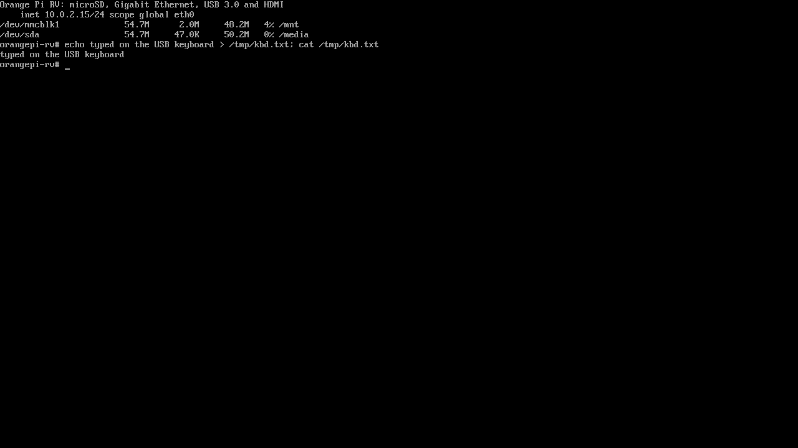

# Orange Pi RV (StarFive JH7110)

`--board orangepi-rv`, experimental.

Xunlong's Orange Pi RV: the StarFive JH7110 with four SiFive U74 cores (RV64GC, Sv39) and
an S7 monitor core, 4 GiB of LPDDR4, a microSD slot, SPI NOR, Gigabit Ethernet, four USB
3.0 ports (a VL805 on PCIe), HDMI 2.0 and an M.2 slot. sbc-emu runs it on its own RV64
interpreter (`riscv64/`, no QEMU) and SoC model (`starfive-jh7110/`). The CPU, the microSD
card, Gigabit Ethernet, the four USB 3.0 ports (PCIe → VL805) with a keyboard, tablet and USB
stick, Wi-Fi (the AP6256 on SDIO) and the HDMI output work. The GPU, audio and the M.2 slot do
not.

Two unmodified kernels boot on it:

| Kernel | Device tree | Works |
|---|---|---|
| Alpine `linux-stable` 7.1.5 (mainline) | mainline `jh7110-orangepi-rv.dtb` | shell, SMP, microSD, Ethernet, USB 3.0, Wi-Fi (`brcmfmac`), reboot/poweroff. No HDMI: mainline has no JH7110 display driver or DT nodes yet |
| Xunlong's own kernel (`orangepi-xunlong/linux-orangepi`, branch `orange-pi-5.15-jh7110`, StarFive's 5.15 BSP), built with `orangepi-build`'s `linux-starfive2-current` config | its `jh7110-orangepi-rv.dtb` | shell, SMP, microSD, Ethernet, USB 3.0, **HDMI** (DC8200 + Inno HDMI, fbcon) with the USB keyboard, RSA on the crypto engine |

```sh
scripts/orangepi-rv-fixture.sh             # pinned Alpine downloads -> cache/orangepi-rv/
scripts/orangepi-rv-vendor-kernel.sh       # Xunlong's kernel, built in Docker -> cache/orangepi-rv/vendor/
F=cache/orangepi-rv; V=$F/vendor
# mainline
sbc-emu run --board orangepi-rv --firmware $F/fw_dynamic.bin --kernel $F/Image \
    --dtb $F/jh7110-orangepi-rv.dtb --initrd $F/initramfs.cpio.gz     # Ctrl-A x quits
# the board's own kernel, with an SD card, a USB stick, Ethernet and the HDMI output on VNC :1
# (the VNC keyboard and pointer are the USB keyboard and tablet)
sbc-emu run --board orangepi-rv --firmware $F/fw_dynamic.bin --kernel $V/Image \
    --dtb $V/jh7110-orangepi-rv.dtb --initrd $F/initramfs.cpio.gz --sd card.img --usb-drive stick.img \
    --append "console=tty0 console=ttyS0,115200 earlycon rdinit=/init" --vnc :1
# --smp 1..4 (default 4), --ram-mb N (default 4096), --net nat|local|none (default nat),
# --hdmi-mode 1280x720|1920x1080|640x480, --screenshot OUT.png, --sd-persist, --script FILE
```

The boot is the board's own chain from the second stage on. On the board, the mask ROM
loads U-Boot SPL, which trains DRAM and starts OpenSBI's `fw_dynamic` at 0x4000_0000 on
every U74, followed by U-Boot. Here the emulator plays the SPL and U-Boot parts:
- It loads OpenSBI at 0x4000_0000 and starts harts 1–4 there. A `fw_dynamic_info` names
  the kernel at 0x4020_0000 (S mode) as the next stage.
- It loads the device tree at 0x4600_0000 and the initrd at 0x4610_0000, U-Boot's
  `starfive_visionfive2` load addresses.
- It fills in `/chosen` and `/memory` as U-Boot would.

Real OpenSBI (Alpine's 1.8.1, generic platform) then runs the platform, HSM, IPIs, timer,
console and system reset.

## Status

| | Status | Evidence |
|---|---|---|
| CPU | RV64IMAFDC + Zicsr, Zifencei, Zicntr, Zba, Zbb (the U74's `rv64imafdc_zba_zbb`), M/S/U at privileged 1.11, Sv39 with superpages and hardware A/D, no ASIDs; all 166 riscv-tests in the U74's ISA pass (`rv64ui/um/ua/uc/uf/ud/si/mi/uzba/uzbb -p`) | `scripts/riscv-tests.sh`, `cargo test -p riscv64` |
| Firmware | OpenSBI 1.8.1 reports `Platform Name: Xunlong Orange Pi RV`, 4 harts, aclint-mswi/mtimer, uart8250, `pm-reset` | `scripts/orangepi-rv-shell.txt` |
| Shell | **mainline:** reaches the `orangepi-rv#` BusyBox prompt at about 3.3 s guest time (about 3.8 G instructions, 30 s wall on an M-series Mac). Checked in the script: `uname -a`; the DT model `Xunlong Orange Pi RV`; 4 CPUs with `rv64imafdc_…_zba_zbb` and `mmu: sv39`; `free -m` 3934 MB; double-precision `awk` math; `sleep 1`; timer and IPI interrupts on all four CPUs; four parallel shell loops | `scripts/orangepi-rv-shell.txt` |
| Reset | `reboot -f` resets through Linux's `gpio-restart` (GPIO35), and OpenSBI and Linux boot again. `poweroff -f` goes through OpenSBI SRST, then the AXP15060 PMIC's power register over I2C5, and the run ends | `scripts/orangepi-rv-reboot.txt` |
| microSD | DesignWare MMC (SDIO1, IDMAC) with card detect on GPIO41: `mmc1: new high speed SDHC card`. A host-made ext4 card mounts; a 4 MiB file written by the guest verifies after dropping the page cache; `fstrim` works; the data survives a guest reboot. The same works on Xunlong's kernel | `scripts/orangepi-rv-sd.txt`, `scripts/orangepi-rv-board.txt` |
| Ethernet | GMAC0 (DWMAC 5.10a, stmmac + `dwmac-starfive`) and the Motorcomm YT8531C PHY on MDIO: `Link is Up - 1Gbps/Full`. On sbc-net's virtual network: a DHCP lease of 10.0.2.15, pings to the gateway, and an HTTP fetch from the host's network through the NAT. Works on both kernels | `scripts/orangepi-rv-net.txt`, `scripts/orangepi-rv-board.txt` |
| USB 3.0 | PCIe0 (PLDA, `pcie-starfive`/`pcie_plda`) with the VL805 xHCI (`1106:3483`) signalling by MSI, as on the board. Both root hubs come up; a USB keyboard, tablet and `--usb-drive` stick enumerate. A key typed on the keyboard arrives as an input event. The stick's ext4 filesystem mounts, and a 2 MiB file written to it verifies after dropping the page cache. Works on both kernels | `scripts/orangepi-rv-usb.txt` |
| Wi-Fi | **mainline:** the AP6256's BCM43456 on SDIO0 (DW MMC with SDIO). `brcmfmac` loads the real `brcmfmac43456-sdio` firmware for `BCM4345/9`, and the emulated FullMAC host interface answers it (the radio and the proprietary firmware are not emulated). The scan finds the virtual access points `sbc-emu` and `sbc-emu-wpa2`; `iw connect` joins `sbc-emu`; DHCP 10.0.2.15 and ping over `wlan0` work. Xunlong's kernel uses Broadcom's out-of-tree `bcmdhd` module instead, which is not set up | `scripts/orangepi-rv-wifi.txt` |
| HDMI | **Xunlong's kernel:** StarFive's DRM driver binds the DC8200 and the Inno HDMI. The connector is `connected`, with the monitor's EDID offering 1280x720, 1920x1080 and 640x480. The HDMI PHY is programmed for 74.25 MHz; `fb0` carries the kernel console (160x45) at 1280x720 with vblank interrupts. Output goes to VNC (`--vnc :N`), `--screenshot` and the script's `screenshot FILE` | `scripts/orangepi-rv-hdmi.txt`, `scripts/orangepi-rv-board.txt` |
| Board devices | Xunlong's kernel: the AXP15060 regulators (`hdmi_1p8`, `hdmi_0p9`, `vcc_3v3`, `cpu_vdd`, …) on I2C5; the 24C04 board EEPROM; the temperature sensor; the crypto engine's PKA, which verifies the kernel's X.509 certificates with RSA | `scripts/orangepi-rv-board.txt` |

The whole board in one run, on Xunlong's kernel (`scripts/orangepi-rv-board.txt`, about 25 s wall):
- microSD read/write;
- Ethernet with DHCP, ping and HTTP;
- the USB stick;
- the HDMI console, where a shell on `tty1` runs a command typed on the USB keyboard.



## What is modelled

- **`riscv64/`: the hart.**
  - An interpreter with a fetch-page cache and a 1024-entry TLB.
  - Floating point runs on host IEEE arithmetic with RISC-V NaN boxing and canonical NaNs. The other rounding modes and the exception flags come from exact error terms.
- **`starfive-jh7110/`: interrupts and timers.** The CLINT (`mtime` at 4 MHz) and the PLIC (136 sources, 9 contexts).
- **`starfive-jh7110/`: the DRAM.** It is visible at 0x4000_0000 and through its uncached alias at +0x4_0000_0000, which the vendor kernel uses for coherent DMA.
- **`starfive-jh7110/`: SoC control.**
  - UART0, the shared DesignWare UART model.
  - The clock/reset generators, with Linux's reset-status semantics.
  - The PLL syscon.
  - The power-management unit's domains.
  - The board's GPIO35 restart line and GPIO41 card detect.
- **`dwmmc.rs`:** the two DesignWare MMC hosts, adapted from the RK3288 model.
- **`gmac.rs`:** GMAC0/GMAC1 (DWMAC4 descriptors, one DMA channel, no offloads advertised) and the YT8531C PHY (RGMII LDO strapped to 1.8 V, as the board's DT drive strengths need). GMAC1 has no PHY, as on the board.
- **`i2c.rs`:** the seven DesignWare I²C controllers, used polled by OpenSBI and with interrupts by Linux. I2C5 carries the AXP15060 PMIC and the 24C04 EEPROM.
- **`display.rs`:**
  - The DC8200: revision 0x5720, plane and panel registers, a 60 Hz vblank, and scanout of the primary planes in the XRGB8888, ARGB8888, RGB565, ARGB1555 and ARGB2101010 formats.
  - The Inno HDMI: hot-plug, PLL lock, and the EDID through its DDC FIFO, for a monitor whose EDID is sbc-emu's (as on the Orange Pi One).
- **`pcie.rs`, `xhci.rs`:**
  - The two PLDA PCIe root ports: ECAM configuration space, the root port bridge, 1:1 address translation, link status in the STG syscon, and INTx plus MSI (ISTATUS_MSI, with ISTATUS_LOCAL's MSI bit as its summary).
  - The VL805 on PCIe0, its xHCI adapted from the Raspberry Pi 4 model. Its interrupter's pending bit clears when an MSI goes out, and a halted controller does not interrupt.
  - PCIe1, the M.2 slot, is empty.
- **`sdio.rs`, `wifi.rs`:**
  - SDIO in the DW MMC model: CMD5/3/7, CMD52, CMD53 through the IDMAC or the FIFO, and the card interrupt as RINTSTS bit 16.
  - The BCM43456, adapted from the Raspberry Pi 4's CYW43455 model: chip revision 9, SDIO ID `02d0:4345`. The access point's network is isolated (DHCP, DNS, local services), as on the Pi.
- **`crypto.rs`:** the security engine's PKA, a Montgomery engine running the vendor driver's RSA sequence. The AES and SHA engines are not modelled.
- **Other devices:**
  - The temperature sensor.
  - All other device pages are read-back stand-ins; every run lists them at the end.
- **Virtual time:**
  - Each hart runs at 1 ns per instruction, round-robin in 1000-instruction slices.
  - When every hart waits in WFI, time skips to the next `mtimecmp`, vblank or network poll.

## Not working yet

- **USB 2.0:** the SoC's own USB 2.0/OTG controller (Cadence, the board's USB-C data role) is not modelled. The devices are emulated: a keyboard, a tablet and a USB stick (`--usb-drive`; a guest reboot starts again from the image).
- **Wi-Fi with Xunlong's kernel:** its `bcmdhd` module and firmware are not in the initramfs. Bluetooth (the AP6256's UART half) is not modelled.
- **Not modelled:**
  - an M.2 card on PCIe1;
  - the PowerVR GPU (Xunlong's kernel loads no firmware, and the driver gives up);
  - audio, MIPI-DSI/CSI, SPI NOR (Cadence QSPI), the RTC.
- **Mainline HDMI:** the mainline kernel has no HDMI output, because mainline Linux has no JH7110 display nodes or Inno HDMI support yet.
- **Firmware:** no mask ROM, U-Boot SPL or U-Boot. Mainline U-Boot recognises the board (EEPROM product ID `XOPIRV`, since 2026.07) and would need the DDR controller, QSPI/SD boot and the EEPROM contents.
- **Distribution images:** Xunlong's Debian images (Google Drive, which refused the download with "quota exceeded") have not been tried. The kernel they use is the one built here.
- **Speed:** interpreter only, about 125 M instructions per second, all harts on one host thread.
