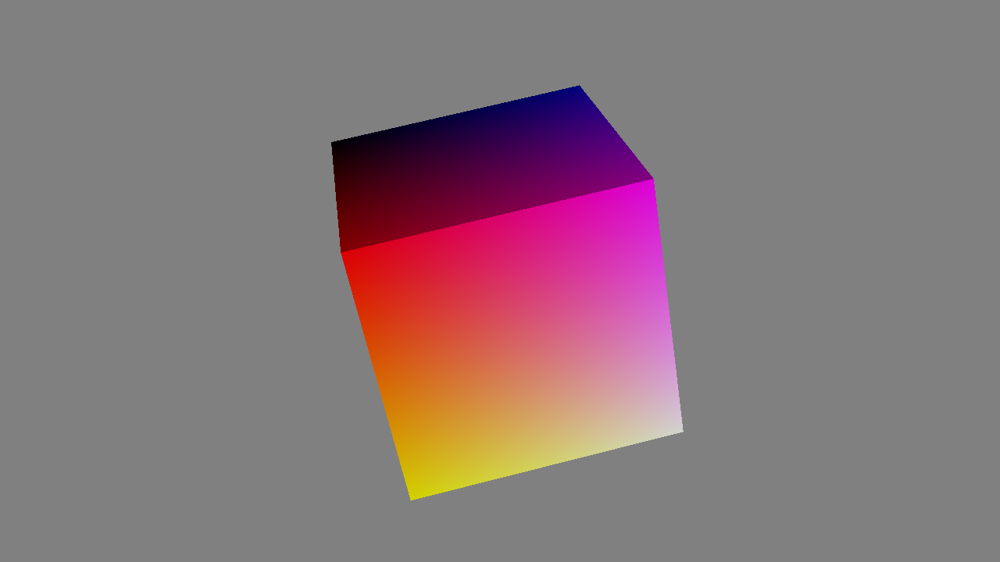

# Orange Pi 5 GPU bring-up

The RK3588S uses a Mali-G610 (Valhall, command-stream frontend), rather than the Pi 4's V3D. Linux uses Panthor and Mesa's Panfrost/PanVK drivers. A scanout device is separate from the GPU. The opt-in `--gpu probe` mode presents the experimental GPU control interface to Linux. Clears, bounded compute dispatch and Mesa's GLES 3D pipeline (vertex and fragment shaders, clipping, depth/stencil, blending, textures) are supported, and the output can be shown on the HDMI screen through the Rockchip display driver: `kmscube` runs on the emulated monitor (see [3D programs](#3d-programs-kmscube)).

The first building blocks in `rk3588` are a GPU virtual-address walker for the 4 KiB AArch64 stage-1 page tables used by Panthor and a bounded interpreter for a small subset of Valhall command-stream instructions. Tests exercise memory mapping and faults, instructions and their interaction. The control register block is connected to guest MMIO and the three GPU interrupt lines. Address-space UPDATE commands latch the programmed translation settings. A synchronous CSF queue path now connects Linux submissions to the command interpreter, including kernel CALL and completion synchronization. Unsupported work raises a queue fault.

Remaining work toward an actual guest GPU:

1. Complete the GPU register model. Initial reset, power, interrupt and MMU address-space programming are implemented; `--gpu probe` exposes a reduced device-tree node, fixed supply and clock operating point for driver bring-up. The CSF global management interface is modeled on the host; Cortex-M7 firmware instructions are not executed.
2. Extend the CSF management interface with queue scheduling, synchronization and command-stream instructions; verify a guest command submission. Panthor initialization and the GPU-info ioctl are now verified. A GPU test fixture needs matching kernel, firmware and Mesa components.
3. Extend the initial shader ISA and compute dispatch, then implement the tiler, vertex and fragment paths and descriptor formats. Compare real guest GPU output with a software renderer; add conformance tests as features are added.
4. Model RK3588 VOP2 and a display output or another explicitly described scanout path, so rendered images can reach the host. Input and desktop support need their own devices.

References: [Linux Panthor registers](https://github.com/torvalds/linux/blob/v6.18/drivers/gpu/drm/panthor/panthor_regs.h), [Panthor MMU](https://github.com/torvalds/linux/blob/v6.18/drivers/gpu/drm/panthor/panthor_mmu.c), and [Mesa Valhall command-stream descriptions](https://chromium.googlesource.com/external/gitlab.freedesktop.org/mesa/mesa/+/06efd8542f442e701685e26abe4d73c4ddf7b249/src/panfrost/genxml/v10.xml).

With the pinned Armbian 26.8.1 image, `--gpu probe --append init=/bin/bash --script scripts/orangepi5-gpu-probe.txt` initializes Panthor and creates `/dev/dri/renderD128`. The script opens that device, queries the GPU ID through the real Panthor ioctl, and waits past the first firmware watchdog ping. This verifies management and discovery, not command submission or rendering.

The host model reads the shared layout installed by Linux from the CSF firmware, validates it through GPU address translation, publishes protocol v1.0, raises the boot interrupt and services configuration, ping and halt requests. Unsupported requests are not acknowledged. Broader shader support, protected mode, performance counters, queue preemption and cross-queue synchronization remain incomplete. A render node alone does not establish OpenGL or Vulkan support.

## Linux clear-pass demo

Build with `cargo build --release`, then run:

```sh
python3 tools/panthor-demo.py --image /path/to/armbian.img
```

The tool boots the pinned Armbian image with the experimental GPU enabled, uploads a Python guest program through serial, and writes `out/panthor-clear-demo.png` plus a serial log. The base SD image stays read-only. The guest uses actual Panthor ioctls to create a VM, map a buffer, create a queue, submit Mali command streams, and wait on a DRM syncobj fence. It verifies every framebuffer byte against the scene before exporting the PNG.

The retro sunset scene is assembled from 2×2 clear regions. Its colors and region boundaries are calculated by the CPU; the emulated fragment engine writes the pixels through GPU memory mappings. This demonstrates Linux submission, command execution, fragment clear writeback and fence completion. It does not demonstrate shader execution, triangle rasterization, Mesa OpenGL/Vulkan, an interactive desktop or display scanout.

The supported fragment descriptor is deliberately narrow: one linear RGBA8 target, identity swizzle, no tiler geometry, shaders, depth/stencil, compression or MSAA. Unsupported descriptors fault rather than silently render incorrectly. Broader rendering still needs shader and tiler implementation.

## Valhall shader triangle

```sh
python3 tools/panthor-demo.py --shader --image /path/to/armbian.img \
  --output out/panthor-triangle.png
```

This Linux demo submits a Mesa-assembled Valhall compute shader through Panthor.
The shader calculates barycentric triangle coverage and RGB interpolation, executes
conditional branches, and writes four float channels per pixel to mapped memory.
The guest waits for a DRM fence, checks the output against an independent coverage
and color calculation, and converts the float buffer to PNG. Coordinates are derived from global invocation IDs, and fixed edge coefficients
are supplied as uniforms. The CPU does not supply pixel colors or coverage results.

Compute dispatch supports bounded three-dimensional workgroups with local, workgroup
and global ID preloads, using a restricted shader descriptor and FAU uniform layout. Supported instructions include
32-bit moves, floating add/FMA, integer add, floating comparisons, conditional
branches and 32/128-bit global loads/stores. Unsupported encodings, modifiers,
configuration or exhausted instruction budgets fault. The fixture source and Mesa
assembler provenance are in `tests/gpu/valhall/`.

This is compute-based shader rendering. Fixed-function vertex/tiler/fragment triangle
drawing, textures, Mesa OpenGL/Vulkan applications and
RK3588 display scanout are still incomplete. Existing clear-pass demos remain available.

The shader demo uses one `RUN_COMPUTE` with 16×16 workgroups of 8×8 local
invocations. Coordinates and output addresses are derived in the shader from
preloaded global IDs; per-pixel CPU uniforms are no longer needed. The source is
`tests/gpu/valhall/workgroup-triangle.asm`. Register allocation is decoded according
to Mesa: descriptor value 0 selects 64 registers per thread, and value 2 selects
32. Unsupported allocation values and preload configurations fault. Dispatch is
bounded to 1,024 local invocations per group, 65,536 total invocations and an
aggregate instruction budget. Workgroup offsets, merging, shared memory and
barriers remain unsupported; invocations execute sequentially.

Valhall's 32-register allocation is split: R0-R15 and R48-R63 are accessible;
R16-R47 are unavailable. This follows Mesa's `bi_allocate_registers` affinity in
[`bi_ra.c`](https://chromium.googlesource.com/external/gitlab.freedesktop.org/mesa/mesa/+/06efd8542f442e701685e26abe4d73c4ddf7b249/src/panfrost/compiler/bifrost/bi_ra.c).
The upper bank supports both reads and writes, including system-value preloads
and vector transfers. The interpreter checks every register in address pairs and
staging vectors before accessing guest memory. The 128-bit load's identity lane
encoding is accepted; reserved lane encodings are rejected.

Run the Linux shader demo in this allocation mode with:

```sh
python3 tools/panthor-demo.py --shader --shader-registers 32 \
  --image cache/orangepi/armbian.img --output out/panthor-shader-32.png
```

Its 32-register shader uses r48/r49 for the two temporaries that the 64-register
variant keeps in r16/r17. Both variants verify the same scene and DRM fence.
Both register modes are used by the native GLES path below. Broader graphics
feature coverage remains incomplete.

### Vertex attribute execution

The interpreter decodes `LD_ATTR_IMM` through real Valhall resource tables,
attribute descriptors and buffer descriptors. It currently supports ordinary 1D
R32F/RG32F/RGB32F/RGBA32F attributes, RGBA/RGB1 ordering, signed byte
offsets, per-vertex indexing and power-of-two instance divisors. Buffer
bounds are checked before translation; an out-of-range element returns zero
source channels with the format's implicit alpha preserved. Descriptor bounds,
unsupported layouts and GPU memory faults stop the submission. Non-power-of-two divisors, vertex
packet buffers, packed/normalized/integer formats and 16-bit register formats
remain unsupported.

```sh
python3 tools/panthor-test.py --image cache/orangepi/armbian.img \
  --guest tests/gpu/panthor-attributes.py --success-marker PANTHOR_ATTRIBUTES_OK \
  --log out/panthor-attributes.log
```

This runs a Mesa-assembled 32-register compute shader through Linux Panthor. Each
invocation fetches a different vertex through an RG32F attribute descriptor and
writes an XY/0/1 vector. A second submission uses a divisor-four instance
descriptor to fetch 12 instance vectors. The guest verifies every vector, write
bounds and both fences.
The same attribute instruction is present in the captured GLES vertex shader.
The runner requires both the marker and a zero guest exit status, and preserves
logs on failure. This test isolates fetch; the GLES demo below validates complete
basic opaque draws.

### Position shader output

`LEA_BUF_IMM` now resolves structured buffer addresses and the vertex engine's
reserved position-output table 13. Address and descriptor bounds are checked
before updating the destination pair. Normal stores honor source-discard hints
on their address register; internally/externally streaming store hints use the
same GPU-MMU write path in the synchronous model. Forced discarded-thread memory
access remains unsupported.

A unit test runs all seven instruction words of the captured Mesa GLES position
shader in 32-register mode, with hardware position storage supplied as a
GPU-mapped buffer. It produces `(2, 2, 0.5, 1)`, `(14, 2, 0.5, 1)`, and
`(8, 14, 0.5, 1)` from the three input vertices and viewport uniforms.

```sh
python3 tools/panthor-test.py --image cache/orangepi/armbian.img \
  --guest tests/gpu/panthor-position.py --success-marker PANTHOR_POSITION_OK \
  --log out/panthor-position.log
```

The Linux test adapts that shader to a compute submission: it copies global X to
the internal-ID register and binds output to an ordinary structured buffer in
table 3 instead of hardware position table 13. It verifies the same vectors,
write bounds and a DRM fence. Those instruction tests isolate the position path. The integrated GLES rendering
path described below also executes `RUN_IDVS`, triangle assembly and fragment
shading; advanced FIFO layouts and the broader graphics pipeline remain incomplete.

### Mesa GLES clear bring-up

`tools/panthor-demo.py --egl --image <mesa-equipped-armbian.img> --output out/panthor-egl.log`
boots Linux, uploads `tests/gpu/panthor-egl.py`, and requires Mesa's Mali/Panfrost
renderer. The guest creates a GBM/EGL GLES2 context and an RGBA8 framebuffer,
submits consecutive clears, waits for completion, and checks every pixel through
`glReadPixels`. Software rendering is rejected. This mode writes a serial log,
not a PNG. The supplied image is opened with the normal copy-on-write behavior.

The test image needs Python 3 and the arm64 `libegl-mesa0`, `libgles2`, and
`libgbm1` packages plus their dependencies. The reference setup uses the pinned
Armbian kernel/firmware with Debian Trixie's Mesa 25.0.7-2+deb13u1; a separate,
expanded 4 GiB image was used to leave enough room for its LLVM dependencies.
The minimal unmodified Armbian fixture does not include these libraries.

The command interpreter supports scoreboard selection and registration of the
tiler heap and OOM handler used during Mesa initialization. Queue registers and
registrations survive doorbells and ring wraps; queue stop, group termination or
firmware reboot discards them. A changed ring or VM requires that reset before
reusing a queue. Hardware heap-chunk allocation
and execution of the OOM handler remain unsupported; basic triangle lists are
modeled on the host. Successful
`STORE_STATE.ERROR_STATUS` writes all eight bytes expected by Mesa's synchronous
debug check. Faulted queues retain their fatal event and stop replaying work until
Linux stops the queue or terminates its group.

The fragment clear path accepts Mesa's single linear RGBA8 target, including the
optional CRC-only extension and its additional framebuffer flags. Whole 16x16
checksum tiles use the descriptor's supplied clear checksum; CRC reads do not
elide writes in the emulator. Partial CRC tiles, depth/stencil, compression,
multiple render targets, advanced shader draws and display scanout remain
unsupported; basic opaque triangle draws are covered by the GLES demo below. `SBC_MALI_TRACE=1` logs command words and framebuffer parameters for
bring-up. Passing this clear test does not establish general OpenGL support.


## On the HDMI screen

```sh
python3 tools/panthor-demo.py --kms --image <mesa-image> --output out/panthor-gles-hdmi.png
```

`tests/gpu/panthor-gles-kms.py` renders the scene below at the monitor's mode (1280x720) into a scanout buffer of the Rockchip display device. It uses GBM and EGL on `/dev/dri/card1`, where Mesa's kmsro pairs `rockchipdrm` with Panthor, as on a real board. It checks interior pixels in the buffer, then shows it with `drmModeAddFB` and `drmModeSetCrtc`. The PNG is the emulated monitor's picture, VOP2's scanout through HDMI0 (see `docs/orangepi5.md`).

The buffer is XRGB8888: Mesa's render target writes it back with a B,G,R,0 swizzle, which the fragment writeback applies. The tile buffer stays RGBA8.


## 3D programs: kmscube

```sh
python3 tools/panthor-app.py --image <image with kmscube> --app kmscube \
  --hdmi-mode 1280x720 --output out/kmscube.png
```

`kmscube` (Debian's package) draws its rotating, lit cube through Mesa's Panfrost driver on the emulated Mali-G610 and flips its frames to the HDMI monitor with page flips; the tool takes screenshots of the monitor while it runs and fails on any GPU queue fault or Mesa error. The model now runs the 3D pipeline Mesa drives:

- **Vertex stage (`RUN_IDVS`)**: every distinct (vertex, instance) is shaded once by the position shader and, when the fragment stage reads varyings, by the varying shader. Positions and varyings stay on the host: on the GPU they go through a 64 KiB FIFO into the tiler heap, a private format. Draw modes: points, lines, line strips/loops, triangles, strips, fans; 8/16/32-bit indices with base vertex, instancing and primitive restart; first or last provoking vertex.
- **Rasterization**: Mesa's vertex shaders end with the viewport transform, so positions are window x, y, z and 1/w. Triangles crossing w = 0 are clipped in homogeneous space; the near/far planes act per fragment through the draw's depth range (cull or clamp), as on Mali. Front-face culling, scissor, polygon offset, and the top-left fill rule on 1/256-pixel snapped coordinates. Varyings are interpolated perspective-correctly (also through clipped edges); flat varyings use the provoking vertex.
- **Fragment stage**: shaders run as 2x2 quads (helper threads when the shader asks for them), so cross-lane permutes (`CLPER`) and implicit-LOD texturing see their neighbours. Early or late depth/stencil tests with all compare functions and stencil operations, fixed-function blending into up to eight render targets, occlusion queries, and pre-/post-frame shaders (Mesa's preload). The tile buffer keeps each target's internal precision (RGBA8, RGB10A2, RGB565, RGBA4, RGB5A1); writeback is linear or 16x16 u-interleaved in any of the matching writeback formats, with sRGB; depth/stencil (D16, D24S8, D24X8, D32) write back through the ZS CRC extension.
- **Shaders**: the interpreter decodes the Valhall ALU (FMA/CVT/SFU: float, half-float, integer, 8/16-bit vector forms, conversions, compares, selects, shifts, cross-lane permutes, Mesa's transcendental sequences) and the messages Mesa emits for GLES: varyings, attributes in any vertex format, UBO/SSBO buffers, global loads and stores, blending, depth output, and texturing.
- **Textures**: 1D/2D/3D, cube maps and arrays; linear and u-interleaved planes; mipmaps with nearest/linear/trilinear filtering and LOD bias/clamps; every wrap mode and border colours; depth comparison, gather and texel fetch; unorm/snorm/float/integer, packed and depth formats with component orders, swizzles and sRGB.

Instruction pages, translations and texture descriptors are cached per job, so the page tables are walked once per page.

The image is the Mesa fixture above with Debian's `kmscube` and `glmark2-es2-drm` packages: boot a copy with `--net nat --sd-persist --append init=/bin/bash`, bring up `eth0` (10.0.2.15/24, gateway 10.0.2.2), and `apt-get install --no-install-recommends kmscube glmark2-es2-drm`. Guest name resolution through the NAT did not work in that session, so `deb.debian.org` and `security.debian.org` went into `/etc/hosts` for the install.



## Real Mesa GLES rendering demo

```sh
python3 tools/panthor-demo.py --gles --image <mesa-equipped-armbian.img> \
  --output out/panthor-gles-demo.png
```

The 512×512 image is read back from a real GLES framebuffer with
`GL_RENDERER=Mali-G610 (Panfrost)`. Mesa compiles the shaders and submits the draw
commands through Linux Panthor. Seventy-two triangle draws, eleven fragment
programs, overlaps and multiple colors form the sun/mountain/prism scene. Its
checker floor uses sampled texture data and interpolated coordinates; the sun
has three translucent halo layers blended over the background. Interior
pixel probes and `glFinish`/`glReadPixels` verify the result before PNG export.
There is no llvmpipe fallback. Use the Mesa-equipped fixture described above.

`tests/gpu/panthor-gles-triangle.py` checks every pixel across three submissions,
with changed background/scale and reversed winding. Run it with
`tools/panthor-test.py --image <image> --guest tests/gpu/panthor-gles-triangle.py
--success-marker PANTHOR_GLES_TRIANGLE_OK --log out/gles-triangle.log`.

The synchronous path implements `RUN_IDVS`, `FINISH_TILING`, heap lifecycle
operations, `RUN_FRAGMENT` and empty-list `FINISH_FRAGMENT`. Vertex shaders write
positions through GPU page tables into the geometry buffer supplied by Mesa.
Opaque polygon lists and heap counters are modeled on the host; they are private
GPU formats, as in the Midgard model. Lists are keyed by VM and tiler context,
scoped to their owning queue, bounded, and discarded on stop/termination/reset.
The native fragment path executes immediate arithmetic, alpha-to-coverage-disabled
`ATEST`, discard flow control, half-float output and opaque `BLEND`. Rasterization
uses the descriptor's single-sample edge rule and scissor. Drawn tiles invalidate
their opaque CRC rather than publishing the uniform-clear checksum.

Indexed and instanced triangle lists also execute native shaders. Element buffers
support unsigned 8-, 16- and 32-bit indices and signed base-vertex addition;
non-indexed draws support a nonzero first vertex. Each instance receives its own
position slots and instance ID, including power-of-two attribute divisors. Index
ranges are validated through the GPU MMU before shaders execute, and position
capacity and invocation budgets account for every instance. A later non-indexed
draw ignores a stale element-buffer address.

`tests/gpu/panthor-gles-indexed.py` runs real Mesa GLES array and element draws,
nonzero first vertices and element-buffer byte offsets, positive and negative
base vertices through `OES_draw_elements_base_vertex`, and instanced variants
with divisors 1, 2 and 4. Every framebuffer pixel is checked against an independent
triangle mask. Run it with:

```sh
python3 tools/panthor-test.py --image <mesa-image> \
  --guest tests/gpu/panthor-gles-indexed.py \
  --success-marker PANTHOR_GLES_INDEXED_OK --log out/gles-indexed.log
```

Single-level, normalized 2D RGBA8 UNORM sampling now executes `TEX_SINGLE`
against Mesa's resource tables and generic linear texture planes. Sampler and
texture indices, GPU mappings, descriptor sizes, row strides and plane extents
are checked before reading texels. Supported states are nearest or bilinear
filtering with equal min/mag filters, clamp-to-edge/repeat/mirrored-repeat, and
channel swizzles including zero/one. Result masks and float16/float32 output
registers are decoded, including native half-float uniform conversion.

The fragment descriptor's helper-thread flag is accepted for this path. With one
mip level and identical min/mag filters, derivatives cannot change LOD or filter
selection. Derivative instructions, mip selection and unequal min/mag filters
remain unsupported. This does not simulate a fragment quad; varying inputs are described below.

`tests/gpu/panthor-gles-texture.py` checks all pixels in 84 Linux/Mesa frames:
texel centers, bilinear averages and edges, out-of-range coordinates and wrapping,
two texture units and varying source alpha. The test uses uniform coordinates;
the varying path below also exercises interpolated texture coordinates. Like the other
GLES fixtures, it requests Mesa's linear layout with `PAN_MESA_DEBUG=sync,linear`.

```sh
python3 tools/panthor-test.py --image <mesa-image> \
  --guest tests/gpu/panthor-gles-texture.py \
  --success-marker PANTHOR_GLES_TEXTURE_OK --log out/gles-texture.log
```

The IDVS secondary vertex stage now writes generic varyings through GPU mappings
into a bounded hardware-output buffer, with separate SRT/FAU selectors. Position
and varying stages share the invocation/instruction limits; combined buffer size
is checked against Mesa's geometry allocation. Each draw retains an immutable
snapshot of its shader-written varying data, so later draws cannot overwrite
previous primitives' interpolation inputs.

`LD_VAR_BUF_IMM` interpolates float32 or float16 source channels at the covered
pixel center (or equivalent single-sample centroid), supports saved-position
store/retrieve/clobber state, and writes float32 or packed float16 results. With
W=1 this is affine barycentric interpolation; perspective correction is not yet
supported. Byte offsets and all vertex spans are checked before destination
registers change. Native half-source FMA, 64-bit stores and packed float conversion
support Mesa's varying shaders without supplying vertex colors from the host.

```sh
python3 tools/panthor-test.py --image <mesa-image> \
  --guest tests/gpu/panthor-gles-varying.py \
  --success-marker PANTHOR_GLES_VARYING_OK --log out/gles-varying.log
python3 tools/panthor-test.py --image <mesa-image> \
  --guest tests/gpu/panthor-gles-varying-texture.py \
  --success-marker PANTHOR_GLES_VARYING_TEXTURE_OK --log out/gles-varying-texture.log
```

These Linux/Mesa fixtures check every pixel in six color-gradient frames
(highp/mediump, both windings) and six textured frames (nearest/bilinear, both
windings and multiple triangle sizes). Texture coordinates come from the native
varying shader, not per-fragment CPU uniforms. Flat varyings, indirect varying loads and fused varying/texture instructions are
now supported too; sample/explicit interpolation positions use the pixel centre.

Fixed-function blending now decodes Mali's `A + B × C` equations independently
for RGB and alpha. Supported operands include source/destination color and alpha,
source-times-two, inverse factors, and the descriptor's scalar blend constant.
The constant follows Mesa's target-format scaling (RGBA8 uses `255 << 8`).
Blend descriptor pointers reserve only their four low bits for RT count;
addresses aligned to 16 bytes retain their remaining address bits. Channel masks
and alpha-to-one are honored; a disabled Off descriptor can omit
its fragment program when the render-target mask is zero and depth/stencil and
occlusion have no side effects.

Fragments composite in submission order in the tile buffer, converted to the
target's internal precision after each write; writeback happens once all draws
have validated and finished. Shader memory side effects are not
rolled back on faults. The native ATEST datum may be copied through a register;
only the disabled, zero datum is supported.

```sh
python3 tools/panthor-test.py --image <mesa-image> \
  --guest tests/gpu/panthor-gles-blend.py \
  --success-marker PANTHOR_GLES_BLEND_OK --log out/gles-blend.log
```

The test checks all pixels in 16 frames, including three overlapping layers,
straight/premultiplied alpha, separate RGB/alpha factors, addition, multiplication,
constants, subtraction, channel masks, disabled color writes, and translucent
rectangles with a shared edge and scissoring. Its oracle uses GL factors, not the
Mali descriptor equation. Blend shaders and logic operations remain unsupported.

The section on kmscube above describes the 3D pipeline these tests now run on. Still
missing: AFBC/AFRC compressed surfaces (run Mesa with `PAN_MESA_DEBUG=noafbc` for
programs that render to textures), block-compressed and ASTC textures, blend shaders
and logic operations, sRGB blending, multisampled rendering (draws are single-sampled
at pixel centres), alpha-to-coverage, anisotropic filtering, explicit-gradient
texturing, image load/store and atomics, non-power-of-two instance divisors' rounding
corner cases, incremental rendering/OOM recovery, cross-queue synchronization and GPU
preemption. Vulkan (PanVK) is untested.
