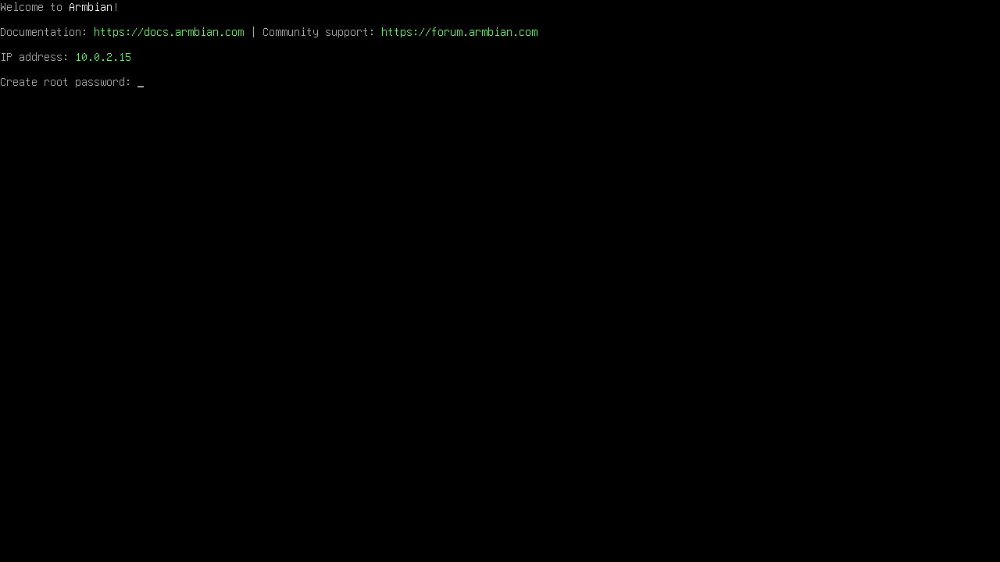

# Orange Pi 5 experimental direct boot

The `orangepi5` board models the RK3588S's eight cores (four Cortex-A55 and four Cortex-A76, reduced to the features the emulator implements), the GICv3 distributor with one redistributor per core, UART2 and the 24 MHz timer. Firmware services (PSCI, including CPU_ON for the secondary cores) are handled by the host; Linux receives a generated reduced device tree. Direct boot supports an optional microSD image through the RK3588S DesignWare MMC controller in PIO mode. The RK3588 GMAC1 Ethernet controller and YT8531 PHY connect to the virtual network. HDMI shows the firmware's framebuffer, the USB 3.0 host carries a keyboard, a tablet and an optional USB stick, and the M.2 slot can hold an NVMe SSD (see below). Wireless and snapshots are not implemented.

## Cores

`--smp N` (1..8, default 8) starts the first N cores: cores 0..3 are the Cortex-A55s (MPIDR 0x000..0x300, MIDR `0x412fd050`), cores 4..7 the Cortex-A76s (MPIDR 0x400..0x700, MIDR `0x414fd0b0`). Linux starts the secondary cores with PSCI CPU_ON. The device tree describes them as the mainline `rk3588s.dtsi` does: `capacity-dmips-mhz` 530/1024, fixed 1.8/2.4 GHz clocks and a `cpu-map` with the A55 cluster and two A76 pairs, so the scheduler sees the A76s as the big cores (capacity 1024 against 397). The GIC routes SPIs by affinity (or to any core with IRM) and delivers SGIs from `ICC_SGI1R_EL1` to their target cores.

By default the cores take turns on one host thread in rounds of 20 µs of virtual time, as on the Raspberry Pi 4 board, so runs are repeatable. `--threads multi` runs each core on its own host thread instead (as QEMU's MTTCG, using the Pi 4's `mt.rs` design): RAM is shared directly, the devices and the GIC's CPU interface are behind one lock, and guest time follows the host clock, so runs are no longer repeatable. Eight busy shell loops pinned to the eight cores finish in 0.94 s of wall time with threads; the single-threaded run takes about 5 G instructions for the same work. Boot is mostly serial: login in 27 s against 39 s. The Armbian image reaches its login prompt in about 7.8 s of guest time on eight cores (37 s wall on an M-series Mac), against 15.2 s guest and 25 s wall on one core. `scripts/orangepi5-smp.txt` (Armbian, `--append init=/bin/bash`) checks the core count, the part numbers, work pinned to each core, per-core timer and IPI counts and the capacities.


## SD root filesystem fixture

A direct-boot initramfs can load the MMC and ext4 modules, mount an ext4 filesystem on the emulated SD card, and switch to its `/sbin/init`. The following reproducible fixture tests that path, including an ext4 write, `sync`, guest reboot and reading the write from the same copy-on-write overlay. The original SD image remains unchanged. This fixture uses a filesystem directly on the card, not a partition table or vendor distribution.

Use the Debian kernel specified above and the modules from the matching `linux-image-6.12.107+deb13-arm64-unsigned_6.12.107-1_arm64.deb` (SHA-256 `2f986ade1a1336423adf2316ea89c3525dd4c05a646b2141626490ca2f388339`). Extract that package to a scratch directory; pass its `usr/lib/modules/6.12.107+deb13-arm64` directory below. The fixture builder requires `mke2fs` and `cpio`, and creates a new output directory rather than overwriting existing images.

```sh
python3 tools/orangepi-sd-root.py --busybox /path/to/busybox.static \
  --modules /path/to/usr/lib/modules/6.12.107+deb13-arm64 \
  --mke2fs /path/to/mke2fs --output out/orangepi-sd-root
./target/release/sbc-emu run --board orangepi5 --kernel /path/to/Image \
  --initrd out/orangepi-sd-root/initramfs.cpio --sd out/orangepi-sd-root/sd-root.img \
  --script scripts/orangepi-sd-root.txt --timeout 60
```

The kernel and initramfs are still loaded directly by the emulator. This does not demonstrate booting an Orange Pi vendor image or loading its bootloader, kernel or initramfs from SD.

The following fixture booted Debian 6.12.107 to a BusyBox shell. The Debian installer kernel is from `https://deb.debian.org/debian/dists/trixie/main/installer-arm64/20250803+deb13u7/images/netboot/debian-installer/arm64/linux`, SHA-256 `9c37ace54ef7e1919411fd912e9f34d6982ddd7f4c8ef3c8aee56f4c4d70db67`. A static AArch64 BusyBox is required; the tested Alpine `busybox-static-1.36.1-r31.apk` has SHA-256 `1d8e7a7fc2ed69bdb8eb7be9d962489c21a0f75b72d8a325437c8a09d4cfac70`.

```sh
cargo build --release
./target/release/sbc-emu mkinitramfs --board orangepi5 --busybox /path/to/busybox.static -o /tmp/orangepi-initramfs.cpio
./target/release/sbc-emu run --board orangepi5 --kernel /path/to/Image --initrd /tmp/orangepi-initramfs.cpio
```

For an SD data disk, add `--sd /path/to/card.img` to the direct-boot command. The base image is opened read-only; guest writes go to a memory overlay that survives guest reboot and is discarded on exit. The kernel must include the DesignWare MMC, Rockchip glue and MMC block drivers, or the initramfs must load them. For persistent writes, `--sd-persist` opens the image exclusively and writes directly to it.

The tested Debian installer initramfs (`20250803+deb13u7/images/netboot/debian-installer/arm64/initrd.gz`, SHA-256 `f8f48fe31f84fca1a43c3d57c09cd1c2ee728549dd18a986463efd0305249451`) contains `dw_mmc.ko.xz`, `dw_mmc-pltfm.ko.xz`, and `dw_mmc-rockchip.ko.xz`. To reproduce the block I/O test, decompress those three modules into the root of the BusyBox initramfs as `/dw_mmc.ko`, `/dw_mmc-pltfm.ko` and `/dw_mmc-rockchip.ko`, create a scratch SD image of at least 1 MiB with `INPUT_SECTOR` at offset 0, then run with `--script scripts/orangepi-sd.txt --timeout 40`. The script loads the modules, reads the image, writes through the guest block device and reads the overlay back after a guest reboot. The model reports a 32-bit PIO interface; MMC DMA, UHS and eMMC are not implemented. `SBC_MMC_TRACE=1` logs card commands.

Ctrl-A x exits. `scripts/orangepi-shell.txt` automates shell input, timer sleep, RAM filesystem, reboot and power-off with `--script`. Use `--timeout 30` to bound a scripted run. This is a generic Debian kernel and custom initramfs, not an Orange Pi vendor image.

## Armbian SD image boot

With an Armbian GPT/ext4 SD image, `--sd` can supply the kernel and initramfs as well as the root filesystem. The emulator performs the relevant firmware loading steps: it reads `Image`, `uInitrd` and `armbianEnv.txt`, then generates its reduced device tree. U-Boot and the board's physical boot chain are not executed, and DT overlays are ignored. By default the SD image remains read-only on the host; guest writes go into a copy-on-write overlay. `--sd-persist` enables direct writes.

Tested with Armbian 26.8.1 Orange Pi 5 Debian Trixie minimal, current 6.18.43 (`Armbian_26.8.1_Orangepi5_trixie_current_6.18.43_minimal.img.xz`, SHA-256 `a7633627a54b6d8c5f03294cbf1b3b998d55b8e1e15cfb5296a3c440b981fcb5`). After verifying and decompressing the image:

```sh
./target/release/sbc-emu run --board orangepi5 --sd /path/to/armbian.img \
  --ram-mb 1024 --script scripts/orangepi5-armbian.txt --timeout 90
```

For SD image boot, `--append` adds options to the image-derived kernel command line; when using `--kernel`, it supplies the complete command line.

The tested image reached `orangepi5 login: root (automatic login)`. The image's first-boot setup and peripheral features are not covered by that result. Direct kernel boot with `--kernel` remains available.

## Ethernet

The reduced device tree exposes GMAC1 and an emulated YT8531 PHY. `--net local` connects the port to the virtual network; the default `--net nat` also enables host network access, and `--net none` disconnects the cable. With the pinned Armbian image, the following exercises the Linux driver and pings the virtual gateway at `10.0.2.2`:

```sh
./target/release/sbc-emu run --board orangepi5 --sd /path/to/armbian.img \
  --append init=/bin/bash --script scripts/orangepi5-ethernet.txt --timeout 600
```

The GMAC model currently provides one DMA queue and basic descriptors, with software checksums. Advanced offloads, multiple queues, hardware timing and physical RGMII signalling are not modeled. The gateway ping is tested; broader application and NAT traffic on this board need additional validation.

## HDMI

The emulated firmware sets up HDMI0 as U-Boot does on boards whose display the kernel does not drive itself: one XRGB8888 framebuffer at the monitor's preferred mode in the top 16 MiB of RAM, described to Linux as a no-map `/reserved-memory` region and a `/chosen/framebuffer` `simple-framebuffer` node. Armbian's udev loads `simpledrm` for it; fbcon switches to 160x45 at 1280x720 and the tty1 getty draws on it.

```sh
./target/release/sbc-emu run --board orangepi5 --sd /path/to/armbian.img --vnc :1
```

`--vnc :N` shows the output to a VNC viewer, `--screenshot OUT.png` and the script's `screenshot FILE` save it, `--hdmi-mode 1280x720|1920x1080|640x480` picks the mode, and `--no-display` turns HDMI off. `scripts/orangepi5-hdmi.txt` boots the image to Armbian's first-run prompt and takes a screenshot. `--dump-dtb FILE` writes the device tree the run booted with, also for SD image boots.

The VOP2 and the HDMI/eDP transmitters are not modelled, so mode setting and hot-plug do not work, and the kernel's own Rockchip DRM driver has no node to bind. The VNC keyboard and pointer are the USB keyboard and tablet.



## USB

The RK3588S's USB 3.0 host (`usb_host2_xhci` at 0xfcd00000, the board's USB-A port, SPI 222) is described as a platform `generic-xhci`, as the firmware leaves its DWC3 glue in host mode, and Linux drives it with `xhci-plat-hcd`. The xHCI register model is the one the Raspberry Pi 4 and Orange Pi RV boards use (the VL805's). A keyboard and a tablet are always plugged in; `--usb-drive IMAGE` adds a USB stick (copy-on-write, each boot starts from the image).

`scripts/orangepi5-usb.txt` (Armbian, `--usb-drive stick.img --append init=/bin/bash`) checks that the three devices enumerate, that a key typed on the USB keyboard arrives as an input event, and that the stick's ext4 filesystem mounts and a 2 MiB file written to it verifies after dropping the page cache.

Limits: the root hub reports four USB 2.0 and four USB 3.0 ports (the VL805's layout, not the DWC3's one of each), and the devices are full/high speed on the USB 2.0 ports. The USB 2.0 hosts (EHCI/OHCI), the USB-C OTG port and the DWC3 global registers are not modelled.

## M.2 NVMe

`--nvme IMAGE` puts an NVMe 1.4 SSD (copy-on-write, each boot starts from the image) in the M.2 slot. The slot's PCIe 2.0 x1 controller (pcie2x1l2) is described as a generic ECAM host (`pci-host-ecam-generic`) in its own windows: configuration space at 0xf4000000 (bus 0 only) and 32-bit memory at 0xf4200000. Linux's PCI core assigns the SSD's 16 KiB BAR; the `nvme` driver brings up its admin and I/O queues on INTA, which is the controller's legacy interrupt (SPI 250). The NVMe model is the Orange Pi RV's, with INTx added.

`scripts/orangepi5-nvme.txt` (Armbian, `--nvme nvme.img --append init=/bin/bash`) checks enumeration, then mounts the SSD's ext4 filesystem and verifies a 4 MiB file written to it after dropping the page cache.

Limits: the DesignWare PCIe controller, its PHY and MSI (through the GIC ITS) are not modelled, so the driver uses one I/O queue on INTx. Only an NVMe SSD can go in the slot.

## Audio

The board's two sound cards are there, as on the real board:

- `rockchip,es8388` (card 0): the headphone jack. The ES8388 codec sits on I2C6 at 0x10 and masters the clocks of I2S1 (`rockchip,rk3588-i2s-tdm`) from its 12.288 MHz MCLK, so it plays the 48 kHz family of rates (8-96 kHz; ALSA's `plughw`/`default` resample others). The codec's DAC mute and volume, its output mixer, the power of the DAC and the outputs and the `Output 1` volume set what reaches the jack. Recording from it works and gives silence.
- `hdmi0` (card 1): HDMI audio on I2S5, which is the clock master (any rate from 8 to 768 kHz; the divided fixed MCLK is snapped to the standard rate it approximates).

DMA controllers DMAC0 (for I2S1) and DMAC2 (for I2S5), Arm PL330s (the shared model in `peripherals/`), feed the I2S FIFOs, which drain at the sample rate in virtual time. `--audio-out FILE` keeps what the headphone jack plays and `--hdmi-audio-out FILE` what HDMI plays: a `.wav` file, or raw 16-bit stereo for any other path (a named pipe for a live player, `ffplay -f s16le -ar RATE -ch_layout stereo PIPE`).

```sh
sbc-emu run --board orangepi5 --sd Armbian.img --audio-out hp.wav --hdmi-audio-out hdmi.wav
# in the guest (the codec starts silent, as the real one does):
amixer -c 0 sset PCM 0dB; amixer -c 0 sset 'Output 1' 0dB
speaker-test -D plughw:0,0 -c 2 -t sine -f 1000 -l 1
aplay -D hw:1,0 music.wav
```

On a full Armbian boot udev loads the drivers and `alsa-restore` restores the mixer. `scripts/orangepi5-audio.txt` (`--append init=/bin/bash`, which loads the modules itself) plays `seq 1 40000` as 16-bit stereo on both cards, at 48 kHz and 44.1 kHz, and records a second; the two WAV files start with exactly those bytes.

Limits: HDMI audio does not go through the HDMI transmitter (the `dw-hdmi-qp` controller is not modelled while the firmware's framebuffer drives the display), so the `hdmi0` card's codec is a plain I2S transmitter (`linux,spdif-dit`) and there are no ELD or channel-map controls. The headphone jack has no detection GPIO. Of each stream, the first two channels are kept.

