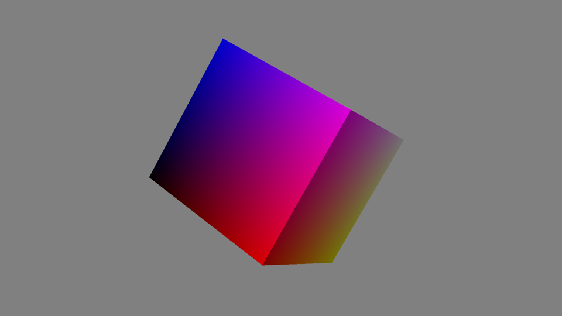

# Raspberry Pi 3: VideoCore IV 3D GPU

The BCM2837's 3D GPU, "V3D 2.1" to Mesa, modelled in `vc4-3d/` from Broadcom's *VideoCore IV 3D
Architecture Reference Guide* (2013) and the Mesa and Linux sources (Mesa's `vc4` Gallium driver,
its copy of the kernel's validator in `src/gallium/drivers/vc4/kernel/`, Linux's `vc4_regs.h`).
This is milestone 7 of the [plan](rpi3-plan.md). Linux's `vc4` binds the V3D as one component of
its DRM device, together with the HVS, pixel valves and HDMI (milestone 4): on the unmodified Pi OS
image (`dtoverlay=vc4-kms-v3d`) `vc4-drm` binds `3fc00000.v3d`, Mesa 26.2 reports
`VC4 V3D 2.1 / OpenGL ES 2.0`, and kmscube, the GLES 2 scenes of the GL suite and glmark2 run on
it ([results](#results-in-the-guest)).

## What is modelled

| Block | Model |
|---|---|
| Registers (`0x7ec0_0000`, ARM `0x3fc0_0000`, GPU interrupt 10) | IDENT0..2 (`V3D 2.1`: 3 slices of 4 QPUs, 2 TMUs per slice, 12 KiB VPM), INTCTL/INTENA/INTDIS (frame done, binner flush done, binner out of memory as a level, overflow-memory used), CT0/CT1 control-list threads (a job starts when CTnEA is written; CTnCA moves to the end address), BFC/RFC counters, PCS, BPCA/BPCS, BPOA/BPOS overflow memory, user QPU programs (SRQPC/SRQUA/SRQCS), cache controls, performance counter registers (read 0), QPU host interrupts (DBQITE/DBQITC) |
| Binning thread (CT0) and tile binner | `TILE_BINNING_MODE_CONFIG` (64x64 tiles, 32x32 in 4x multisample mode), state packets, GL and NV shader records (extended strides too), indexed (8/16-bit) and array primitives in all seven modes; vertices through the coordinate shader; clipping against the near and far planes (from the clipper Z scale) and the 12.4 guard band; face culling; each primitive into the lists of the tiles its bounding box touches, after the state packets each list has not seen; lists in the initial blocks, then blocks from the tile allocation memory, then the kernel's overflow memory: when that is gone too the binner waits with OUTOMEM up until BPOS is written again; `FLUSH` ends every list with a return |
| Rendering thread (CT1) | `TILE_RENDERING_MODE_CONFIG`, `CLEAR_COLORS`, tile coordinates (loads happen there, as on the hardware), branches and sub-lists, the semaphore with the binner, `STORE_TILE_BUFFER_GENERAL`/`LOAD_TILE_BUFFER_GENERAL` (colour RGBA8888 or BGR565, Z+stencil, Z, VG mask; raster, T or LT; sample 0 or resolved), `STORE_MS_TILE_BUFFER(_AND_EOF)`, full-resolution loads and stores (the raw per-sample layout Mesa's `txf_ms` lowering reads), clears on store unless disabled |
| Setup and rasterizer | 12.4 screen positions plus the viewport offset, top-left fill rule at pixel centres (four rotated-grid samples in 4x mode), the clip window, depth offset (factor and units), Zs to 24 bits, 1/Wc for perspective; lines and points as quads with their line and sprite coordinates as the hardware varyings Mesa expects |
| Fragment shading and the tile buffer (TLB) | four 2x2 quads per program run; the W and Z payload in ra15/rb15; varyings as the varying unit gives them (the shader multiplies by W and adds C from r5); flat shading flags; TLB Z writes with the depth test and Z updates from the configuration bits; stencil setup words (front, back, both, write masks) with all eight ops and functions; colour writes to all samples or sample by sample; colour, coverage and VG-mask loads into r4; the multisample mask; the reverse-facing flag; conditional writes for discards |
| QPU | 16 lanes; every add and multiply operation; register files A and B, accumulators r0–r5 (r5 by quad or replicated), the uniform stream and its address register, small immediates and the multiply pipe's vector rotation, 32-bit and per-element load immediates, semaphores, the mutex, branches (relative, absolute, by register; all and any conditions; three delay slots; link), program end with its two delay slots, thread switches (no-ops: each program runs to its end), flags from either pipe, regfile-A pack (16-bit float or integer, 8-bit, saturating) and unpack, multiply-pipe colour pack, r4 unpack; SFU (recip, rsqrt, exp2, log2 into r4) |
| TMU | requests by coordinate writes with the configuration words taken from the uniform stream (P0, P1, P2/P3), direct memory reads (S only); RGBA8888, RGBX8888, RGBA4444, RGBA5551, RGB565, luminance, alpha, luminance-alpha, ETC1, S8/S16, RGBA32R; T, LT and raster layouts; mip levels below the base with power-of-two sizes; repeat, clamp, mirror, border (colour from R); nearest, bilinear and the four mipmap filters with the LOD from each quad, bias or explicit LOD; cube maps (face from the major axis, face stride from P2) |
| VPM | generic reads and writes (32-bit, 16/8-bit laned, horizontal and vertical); for vertex batches the vertex cache DMA loads the attributes one vertex per column and the shaders' outputs are read back from their own rows; VPM DMA loads and stores (32-bit) for user programs |
| User QPU programs | the queue (16 deep), twelve QPUs in turns, semaphores and the mutex between programs, completion counts |

Vertices are shaded once per job and cached (the hardware shades again for each tile; the
results are the same). The tile lists' primitive records are this model's own encoding (`bin.rs`
describes it): only the rendering thread reads them, and nothing in Linux or Mesa looks inside.

## Jobs, time and threads

A job runs when the kernel writes CTnEA, either in that register write (one-thread mode, the
browser; deterministic) or, with `--threads multi`, on a GPU thread of its own while the cores run
on. A binning job's lists are laid out in memory by the device itself (it owns the overflow
registers), so the out-of-memory wait works in both modes. The done interrupt comes after the
host time the job took, scaled by `SBC_GPU_TIME` (default 1) and capped at 50 ms (well inside the
kernel's hang check), or as soon as the GPU thread has finished. While a job runs on the GPU
thread, CTnCA reads move, so the kernel's hang check sees progress. Snapshots keep the registers,
pending interrupts, the clear values and a binning job waiting for memory (or finished on the GPU
thread but not collected yet).

## Tests

`cargo test -p vc4-3d` (57 tests) and `cargo test -p bcm2837` (`v3d_on_the_bus`):

- QPU: every add and multiply operation against Rust references, flags and all conditions
  (integer carry and borrow, float sign), packs and unpacks (16-bit float and integer halves,
  bytes, saturation, colour packs), small immediates and rotations, load immediates, the uniform
  stream and its reset, the SFU, r5 replication, branches (delay slots, link, all/any), program end,
  the TMU (direct reads and a texture), VPM generic access, two user programs that hand data over
  with a semaphore and VPM DMA, the disassembler.
- Layouts: T, LT and raster addressing against Mesa's `t_utile_address`, bijectivity for all
  sizes, tile-buffer stores and loads in every layout, BGR565.
- TMU: T-tiled nearest with repeat, bilinear with clamp, 565/4444/alpha expansion, mip level
  placement, ETC1, cube faces.
- End to end, through the registers as Linux drives them, with hand-assembled coordinate, vertex
  and fragment shaders, shader records and binning lists as Mesa writes them and rendering lists
  as the kernel builds them: clears in raster/T/LT; a pixel-aligned rectangle covering exactly its
  pixels (fill rule); indexed strips, fans and back-face culling; Gouraud and perspective-correct
  varyings; nearest texture mapping (each texel exactly); depth test in both draw orders with the
  stored Z; additive blending through the colour load; stencil marking and masking; a triangle far
  outside the guard band covering a 2x3-tile frame, near-plane clipping, w < 0; points and wide
  lines; 4x multisampling resolved; the out-of-memory wait with the kernel's overflow chunks; done
  interrupts after host time; jobs on the GPU thread (`--threads multi`); a snapshot while waiting
  for memory; identification as Mesa reads it;
  capture and replay.
- The machine: the registers at 0x3fc0_0000, a job writing RAM through the 0xc000_0000 alias, the
  interrupt at the ARM-side controller and its acknowledgement, a snapshot round trip.

## Debugging

- `SBC_VC4_LOG=1`: a line per job (primitives, fragments, host time).
- `SBC_VC4_CL=1`: every control-list packet both threads execute (tile lists included).
- `SBC_VC4_TRACE=N`: the first N QPU instructions, disassembled.
- `SBC_VC4_DUMP=dir`: each finished frame as a PPM.
- `SBC_VC4_CAPTURE=dir`: every job with the RAM pages it touches (as they were before it ran) in
  `dir/jobs.bin`; `vc4-replay dir/jobs.bin [first] [count]` (`cargo run --release -p vc4-3d
  --bin vc4-replay`) runs them again on the host in milliseconds, with the options above. This is
  how guest captures (once Mesa runs in the guest) become host tests.

## Performance

The interpreter: a 1920x1080 frame of 7680 Gouraud-shaded, depth-tested triangles with 4x overdraw
(8.3 M fragments, 10 M QPU instructions of 16 lanes) renders in about 310 ms of host time on an
M-series Mac (`cargo test --release -p vc4-3d -- --ignored bench --nocapture`); the QPU
interpreter takes about two thirds of it, rasterization and the tile buffer the rest. By that
measure a frame with one screen's worth of simple shading (kmscube's scale) should take some
40–80 ms; guest workloads will tell. A QPU JIT
(to AArch64 and WebAssembly, as the Maxwell shader JIT) would take the larger part away; it is
worth doing once guest workloads (glmark2, the desktop) show where the time goes.

## Results in the guest

Raspberry Pi OS Lite (trixie, kernel 6.18.50, Mesa 26.2.6) with Mesa, kmscube, glmark2 and gcc
(the GPU image of `scripts/raspios-gpu-setup.txt`, copy-on-write), HDMI at 1920x1080 through vc4 KMS.

**Bring-up and kmscube** (`scripts/rpi3-v3d.txt`, from the first boot, saves `out/rpi3-v3d.snap`):
`vc4-drm soc:gpu: bound 3fc00000.v3d (ops vc4_v3d_ops [vc4])`; `eglinfo` on GBM: `OpenGL ES
profile renderer: VC4 V3D 2.1`, `OpenGL ES 2.0 Mesa 26.2.6`; kmscube's lit cube on HDMI,
600 frames at 58.8 fps (guest time; each 1080p frame takes about 14 ms of host time).

**The GLES 2 scenes of the GL suite** (`tests/gpu/gles2test.c`, 128x128) on the V3D against
llvmpipe in the same guest, a scene at a time (`tools/serial_test_script.py` writes the script:
the source goes in over the serial console, it is built with gcc in the guest):

| Scene | Result |
|---|---|
| clear, blend_modes, tex_nearest, tex_formats, tex_etc1, stencil, scissor, polygon_offset, branches | pass, exact |
| colormask, discard_fragcoord, vs_math, near_clip, loop_fragdepth | pass (max difference 1–2) |
| tri_color, depth, blend, cube, points_lines, indexed, cubemap, fbo_texture | pass (under 0.2% of pixels differ: edges) |
| tex_linear_mip | pass (0.12% of pixels, max 17: filtering at level transitions) |
| many_tris | differs (22% of pixels): 20000 sub-pixel triangles; the image matches a model of the hardware's 12.4 snapping to 3 of 16384 pixels, llvmpipe snaps to 1/256 pixel |
| derivatives_math | not run: Mesa's vc4 does not offer `GL_OES_standard_derivatives` |

The guest runs found three model bugs, all fixed with unit tests: the configuration's "clockwise"
bit means clockwise with y up (kmscube showed the cube's back faces), a conditional instruction sets
the flags only in the lanes where it executes (Mesa's loops ended after one pass), and ETC1's
differential base colours wrap as Mesa's decoder does.

**glmark2-es2-drm** (`scripts/rpi3-glmark2.txt`, 2023.01, 1920x1080 on HDMI, all scenes at their
default durations): every scene runs to its end, `GL_RENDERER: VC4 V3D 2.1`, **glmark2 Score: 21**.
The frame rates are guest-time rates: a job's done interrupt waits for the host time it took, but
at most 50 ms (well inside the kernel's hang check), so scenes whose frames take longer report about
20 fps (most of the shading scenes; their real host cost is higher). build 57 fps; texture 31/24/23;
gouraud 41; ideas 25; pulsar 26; desktop blur 2, shadow 10; terrain 3; refract 5; shadow 14;
jellyfish 21. The pictures were not compared against a reference (glmark2's own `--validate`
references do not match llvmpipe either, as on the Pi 4).

## Not modelled or not verified yet

- Early Z is not used to skip fragments (results are the same: the late test decides).
- BGR565 stores do not dither; the 64-bit (HDR) tile buffer has only its tile size.
- Per-sample Z in 4x mode is the pixel centre's; sample positions are a standard rotated grid.
- TMU: child images, BW1/A4/A1/RGBA64/YUV422R, the cache swizzle; no TMU or SFU latencies (results
  are there at once: correct programs do not notice).
- VPM DMA in 16- and 8-bit modes; VG shader state; the alpha-mask and VG-mask paths are minimal.
- Performance counters read 0.

## Remaining

- The desktop (Pi OS with desktop, labwc) on the GPU.
- A QPU JIT (AArch64 and WebAssembly) once workloads show the interpreter is the bottleneck.
